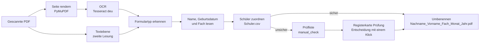

<p align="center">
  
</p>

<h1 align="center">PDF Datei Umbenenner</h1>

<p align="center">
  Automatisches Umbenennen gescannter Anwesenheitsnachweise nach Schüler, Fach und Monat —<br>
  lokale Texterkennung, Abgleich mit dem eigenen Schülerverzeichnis und eine schnelle Prüfung für Windows-Büros.
</p>

<p align="center">
  
  
  
  
  
</p>

<p align="center">
  <a href="README.md">English</a> · <b>Deutsch</b> · <a href="README.ru.md">Русский</a>
</p>


## Wozu

Nachhilfeanbieter, die mit dem Jobcenter abrechnen, erhalten für jeden Schüler, jedes Fach und jeden Monat einen unterschriebenen Anwesenheitsnachweis. Der Scanner speichert die Blätter als `Scan_0001.pdf`, `Scan_0002.pdf`, … — und jemand muss jede Datei öffnen, Name und Fach ablesen und sie umbenennen, bevor sie abgelegt oder abgerechnet werden kann. PDF Datei Umbenenner erledigt das automatisch:

```text
Scan_2026-09-30_0001.pdf  →  Beispiel_Lena_Mathematik_September_2026.pdf
Scan_2026-09-30_0002.pdf  →  Muster_Max_Deutsch_September_2026.pdf
Scan_2026-09-30_0006.pdf  →  Prüfung: neuer Schüler „Hoffmann Sophie“ (Geburtsdatum vorausgefüllt)
```

Ist sich das Programm nicht sicher, rät es nie: Das Dokument kommt mit einem vorbereiteten Vorschlag in die Prüfliste, und eine Mitarbeiterin oder ein Mitarbeiter bestätigt ihn mit einem Klick.

## Funktionen

- **Zwei Formulartypen.** Der *Anwesenheitsnachweis* (mit oder ohne Spalte *GR/EZ*) und ein älteres Formular mit der Kopfzeile „Nachname Vorname Fach“. Der Typ wird am Seiteninhalt erkannt, nie am Dateinamen.
- **Robustes Lesen echter Scans.** Jede Seite wird mit Tesseract OCR gelesen; die Textebene des Scanners dient als unabhängige zweite Lesung. Beschriftungen werden trotz typischer OCR-Fehler gefunden, seitlich oder kopfüber gescannte Seiten werden aufgerichtet, und Einträge der Spalte *GR/EZ* werden nie für das Fach gehalten.
- **Sorgfältige Schülerzuordnung.** Namen werden mit einer geschlossenen Liste (`Schuler.csv`) abgeglichen, ein optionales Geburtsdatum dient als zusätzliches Merkmal. Typische OCR-Verwechslungen (`i/l/1`, `rn/m`, `o/a` …) werden nur nach einer strengen Regel korrigiert; ähnliche oder neue Schüler gehen immer in die Prüfung.
- **Prüfung mit einem Klick.** Die Registerkarte *Prüfung* zeigt die Ausschnitte von Name, Geburtsdatum und Fach aus dem Scan, eine Schülersuche während der Eingabe und vorbereitete Entscheidungen: vorgeschlagenen Schüler übernehmen, neuen Schüler mit den erkannten Daten anlegen oder ein neues Fach übernehmen.
- **Schülerverzeichnis.** Schüler bearbeiten, deaktivieren und Dubletten finden, Aliasnamen verwalten, CSV-Dateien mit Vorschau jeder Änderung und automatischer Sicherung importieren.
- **Sicherer Umgang mit Dateien.** Testmodus, atomares Schreiben, kein Überschreiben (Zusätze `_1`, `_2`), Rücksetzen bei Teilfehlern; es wird nichts gelöscht.
- **Bereit für Büro-PCs.** `setup.bat` installiert Python auf Nachfrage (mit Signaturprüfung), prüft Tesseract, legt Verknüpfungen mit dem Programmsymbol an und erklärt jeden Fehler verständlich auf Deutsch. Das Programm startet ohne Konsolenfenster und läuft je Installation nur einmal.
- **Datenschutz durch Technikgestaltung.** Alles läuft lokal. Keine Cloud-Texterkennung, keine Telemetrie; Verzeichnisse, Scans und Prüfliste verlassen den Rechner nicht.

## Bildschirmfotos

| Ordner verarbeiten | Prüfung: neuer Schüler |
| --- | --- |
| [](docs/images/processing.png) | [](docs/images/review-new-student.png) |
| **Prüfung: neues Fach bei bekanntem Schüler** | **Schülerverzeichnis** |
| [](docs/images/review-new-subject.png) | [](docs/images/students.png) |

Alle Bildschirmfotos zeigen die erfundenen Beispieldaten aus [`demo/`](demo/).

## So funktioniert es



Monat und Jahr stammen immer aus der Auswahl im Programm, nie aus Datumsangaben auf dem Formular. Einzelheiten: [Funktionsweise der Erkennung](docs/de/how-it-works.md).

**Gemessen an echten Scans.** Bei 17 echten Scans aus dem Alltag (nicht veröffentlicht) trifft die aktuelle Version 12 richtige automatische Entscheidungen, **0 falsche**, und gibt 5 Dokumente in die Prüfung — alle zu Recht, weil 4 Schüler noch nicht im Verzeichnis standen. Nach ihrer Aufnahme werden 17 von 17 Dokumenten automatisch umbenannt. Die Verarbeitung dauert etwa 2–3 Sekunden je Dokument. Die Stichprobe ist klein — die Zahlen sind ein Anhaltspunkt, keine Garantie.

## Schnellstart

1. Das Repository als ZIP herunterladen, **entsperren** (*Eigenschaften → Zulassen*) und in einen lokalen Ordner entpacken, z. B. `C:\Users\<Name>\PDF-Datei-Umbenenner` — nicht in OneDrive und nicht auf ein Netzlaufwerk.
2. [Tesseract OCR](docs/de/installation.md#2-tesseract-ocr-installieren) mit den deutschen Sprachdaten installieren.
3. Das eigene Schülerverzeichnis `Schuler.csv` in den Programmordner kopieren (Format: `Nummer;Nachname;Vorname[;Geburtsdatum]`).
4. `setup.bat` doppelklicken. Es installiert bei Bedarf Python (nach Rückfrage), richtet eine eigene Umgebung ein und bietet Verknüpfungen auf dem Desktop und im Startmenü an.
5. **PDF Datei Umbenenner** über die Verknüpfung starten, den Ordner mit den Scans, Monat und Jahr wählen und *Verarbeitung starten* klicken.

Ausführlich: [Installation und Betrieb](docs/de/installation.md) · [Benutzerhandbuch](docs/de/user-guide.md)

## Demo ausprobieren

Der Ordner [`demo/`](demo/) enthält sieben erfundene Scans und ein passendes Schülerverzeichnis. Nach `setup.bat`:

```cmd
.venv\Scripts\python.exe demo\run_demo.py
```

```text
Scan_2026-09-30_0001.pdf  -> Beispiel_Lena_Mathematik_September_2026.pdf
Scan_2026-09-30_0002.pdf  -> Muster_Max_Deutsch_September_2026.pdf
Scan_2026-09-30_0003.pdf  -> Schneider_Jonas_Englisch_September_2026.pdf
Scan_2026-09-30_0004.pdf  -> Weber_Mia_Biologie_September_2026.pdf
Scan_2026-09-30_0005.pdf  -> Probe_Paula_Physik_September_2026.pdf
Scan_2026-09-30_0006.pdf  -> Prüfung: Kein passender Schüler im Verzeichnis gefunden; vermutlich ein neuer Schüler. …
Scan_2026-09-30_0007.pdf  -> Prüfung: Unbekannte Fachwerte im Tabellenfeld: Latein; …
```

Das Skript arbeitet mit einer Kopie in `demo\output`; die Demodateien und das eigene Verzeichnis bleiben unverändert. `--dry-run` plant nur die Namen.

| Anwesenheitsnachweis | Älteres Formular |
| --- | --- |
|  |  |

## Dokumentation

| Thema | English | Deutsch | Русский |
| --- | --- | --- | --- |
| Installation, Start, Aktualisierung, Rückgabecodes | [installation](docs/en/installation.md) | [Installation](docs/de/installation.md) | [установка](docs/ru/installation.md) |
| Arbeit mit dem Programm: Verarbeitung, Prüfung, Verzeichnis | [user guide](docs/en/user-guide.md) | [Benutzerhandbuch](docs/de/user-guide.md) | [руководство](docs/ru/user-guide.md) |
| Erkennung, Zuordnungsregeln, Datensicherheit | [how it works](docs/en/how-it-works.md) | [Funktionsweise](docs/de/how-it-works.md) | [как это работает](docs/ru/how-it-works.md) |
| Kommandozeile, API, Tests, Messstand | [development](docs/en/development.md) | [Entwicklung](docs/de/development.md) | [разработка](docs/ru/development.md) |

## Datenschutz

Das Programm verarbeitet personenbezogene Daten von Schülerinnen und Schülern (Namen, Geburtsdaten). Es ist darauf ausgelegt, diese Daten auf dem Rechner zu belassen, auf dem sie verarbeitet werden:

- Die Texterkennung läuft lokal mit Tesseract; keine Datei wird hochgeladen. Internet wird nur bei der Installation benötigt.
- Das Verzeichnis (`Schuler.csv`, `Lehrer.csv`), gelernte Aliasnamen, die Prüfliste und alle Scans sind per [`.gitignore`](.gitignore) von Git ausgeschlossen.
- Tests, Dokumentation und Demo verwenden ausschließlich erfundene Namen. Bitte niemals echte Scans oder Verzeichnisse an Issues anhängen.

## Projektstruktur

```text
gui_main.py, start_gui.py        Tkinter-Oberfläche und Startpunkt für die Starter
processing_service.py            eine Verarbeitungskette für GUI und Kommandozeile
pdf_extractor.py, ocr.py         Rendern, Tesseract-OCR, Textebene
form_parser.py, text_parser.py   Formularerkennung und Lesen der Felder
name_matching.py                 OCR-gerechter Namensvergleich
student_registry*.py             Verzeichnis, Aliasnamen, Zuordnung, CSV-Import
review_*.py                      Prüfliste, Entscheidungen, Scan-Ausschnitte
file_renamer.py, validator.py    sicheres Umbenennen und Fachprüfung
desktop_integration.py           eine Instanz, Symbol, Fenstergröße (Windows)
setup.bat, start_app.bat, …      Installation und Starter, Prüfungen in bootstrap.py
demo/                            erfundene Scans, Verzeichnis und Demo-Skript
tools/evaluate_recognition.py    Messstand für Ordner mit echten Scans
tests/                           pytest-Suite (Einheiten, GUI, cmd.exe-Starter, OCR)
```

## Entwicklung

```cmd
.venv\Scripts\python.exe -m pip install -r requirements-dev.txt
.venv\Scripts\python.exe -m pytest
```

Die Suite prüft die Verarbeitungskette, die Oberfläche mit echten Tk-Widgets, die BAT-Starter in einem echten `cmd.exe` und einen vollständigen OCR-Durchlauf mit den Demo-Scans (wird ohne Tesseract übersprungen). Architektur, Kommandozeile und Messstand: [Entwicklung](docs/de/development.md).

## Lizenz

Der Quellcode steht unter der [MIT-Lizenz](LICENSE). © 2025–2026 Konstantin Shakun.

Fremdkomponenten behalten ihre eigenen Lizenzen: [PyMuPDF](https://pymupdf.readthedocs.io/) ist von Artifex doppelt lizenziert — **AGPL-3.0** oder kommerziell. Es wird separat über `pip` installiert; wer das Programm zusammen mit PyMuPDF weitergibt, muss für diese Weitergabe die AGPL-Bedingungen einhalten. pdfplumber, pdfminer.six und Pillow stehen unter MIT-artigen Lizenzen, pypdfium2 unter Apache-2.0/BSD-3-Clause, [Tesseract OCR](https://github.com/tesseract-ocr/tesseract) unter Apache-2.0.
