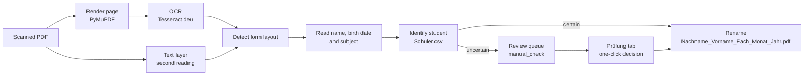

<p align="center">
  
</p>

<h1 align="center">PDF Datei Umbenenner</h1>

<p align="center">
  Automatic renaming of scanned attendance forms by student, subject and month —<br>
  local OCR, matching against your own student registry and a fast review workflow for Windows offices.
</p>

<p align="center">
  
  
  
  
  
</p>

<p align="center">
  <b>English</b> · <a href="README.de.md">Deutsch</a> · <a href="README.ru.md">Русский</a>
</p>


## Why

Tutoring providers that work with job centres receive a signed attendance form for every student, subject and month. The scanner saves them as `Scan_0001.pdf`, `Scan_0002.pdf`, … and someone has to open each file, read the name and the subject and rename it before it can be filed or invoiced. PDF Datei Umbenenner does this automatically:

```text
Scan_2026-09-30_0001.pdf  →  Beispiel_Lena_Mathematik_September_2026.pdf
Scan_2026-09-30_0002.pdf  →  Muster_Max_Deutsch_September_2026.pdf
Scan_2026-09-30_0006.pdf  →  review: new student "Hoffmann Sophie" (birth date prefilled)
```

When the program is not certain, it never guesses: the document goes to a review queue with a prepared proposal, and the operator confirms it with one click.

## Features

- **Two form layouts.** The attendance record *Anwesenheitsnachweis* (with or without a *GR/EZ* column) and an older layout with a "Nachname Vorname Fach" header line. The layout is recognised from the page content, never from the file name.
- **Robust reading of real scans.** Every page is read with Tesseract OCR; the scanner's text layer serves as an independent second reading. Labels are found despite typical OCR errors, sideways and upside-down scans are turned upright, and *GR/EZ* entries are never mistaken for the subject.
- **Careful student identification.** Names are matched against a closed list (`Schuler.csv`) with an optional birth date as an extra key. Typical OCR confusions (`i/l/1`, `rn/m`, `o/a` …) are corrected only under a strict rule; similar or new students always go to review.
- **One-click review.** The *Prüfung* tab shows the scan fragments of name, birth date and subject next to the form, a live student search and prepared decisions: take the suggested student, create a new student with the recognised data, or adopt a new subject.
- **Registry management.** Edit, deactivate and deduplicate students, manage aliases, import CSV files with a preview of every change and automatic backups.
- **Safe file handling.** Dry-run mode, atomic writes, no overwriting (`_1`, `_2` suffixes), rollback on partial failures, nothing is deleted.
- **Ready for office PCs.** `setup.bat` installs Python on request (signature-checked), checks Tesseract, creates shortcuts with the app icon and explains every error in plain German. The app starts without a console window and runs only once per installation.
- **Private by design.** Everything runs locally. No cloud OCR, no telemetry; registries, scans and the review queue never leave the computer.

## Screenshots

| Processing a folder | Review: new student |
| --- | --- |
| [](docs/images/processing.png) | [](docs/images/review-new-student.png) |
| **Review: new subject for a known student** | **Student registry** |
| [](docs/images/review-new-subject.png) | [](docs/images/students.png) |

All screenshots use the fictional demo data from [`demo/`](demo/).

## How it works



Month and year always come from the operator's selection, never from dates on the form. Details: [How recognition works](docs/en/how-it-works.md).

**Measured on real scans.** On 17 real scans from daily operation (not published), the current version makes 12 correct automatic decisions, **0 wrong ones**, and sends 5 documents to review — all justified, because 4 students were not yet in the registry. After adding them, 17 of 17 documents are renamed automatically. Processing takes about 2–3 seconds per document. The sample is small, so treat these numbers as an indication rather than a guarantee.

## Quick start

1. Download the repository as a ZIP file, **unblock it** (*Properties → Unblock*) and extract it to a local folder such as `C:\Users\<Name>\PDF-Datei-Umbenenner` — not into OneDrive and not onto a network drive.
2. Install [Tesseract OCR](docs/en/installation.md#2-install-tesseract-ocr) with the German language data.
3. Copy your student registry `Schuler.csv` into the program folder (format: `Nummer;Nachname;Vorname[;Geburtsdatum]`).
4. Double-click `setup.bat`. It installs Python if necessary (after asking), sets up a private environment and offers desktop and Start menu shortcuts.
5. Start **PDF Datei Umbenenner** from the shortcut, choose the folder with the scans, the month and the year, and click *Verarbeitung starten*.

Full guide: [Installation and operation](docs/en/installation.md) · [User guide](docs/en/user-guide.md)

## Try the demo

The [`demo/`](demo/) folder contains seven fictional scans and a matching student registry. After `setup.bat` has run:

```cmd
.venv\Scripts\python.exe demo\run_demo.py
```

```text
Scan_2026-09-30_0001.pdf  -> Beispiel_Lena_Mathematik_September_2026.pdf
Scan_2026-09-30_0002.pdf  -> Muster_Max_Deutsch_September_2026.pdf
Scan_2026-09-30_0003.pdf  -> Schneider_Jonas_Englisch_September_2026.pdf
Scan_2026-09-30_0004.pdf  -> Weber_Mia_Biologie_September_2026.pdf
Scan_2026-09-30_0005.pdf  -> Probe_Paula_Physik_September_2026.pdf
Scan_2026-09-30_0006.pdf  -> Prüfung: Kein passender Schüler im Verzeichnis gefunden; vermutlich ein neuer Schüler. …
Scan_2026-09-30_0007.pdf  -> Prüfung: Unbekannte Fachwerte im Tabellenfeld: Latein; …
```

The script works on a copy in `demo\output`; the demo files and your own registry stay unchanged. `--dry-run` only plans the names.

| Attendance record (*Anwesenheitsnachweis*) | Older layout |
| --- | --- |
|  |  |

## Documentation

| Topic | English | Deutsch | Русский |
| --- | --- | --- | --- |
| Installation, start, updates, exit codes | [installation](docs/en/installation.md) | [Installation](docs/de/installation.md) | [установка](docs/ru/installation.md) |
| Daily work: processing, review, registry | [user guide](docs/en/user-guide.md) | [Benutzerhandbuch](docs/de/user-guide.md) | [руководство](docs/ru/user-guide.md) |
| Recognition, identification rules, data safety | [how it works](docs/en/how-it-works.md) | [Funktionsweise](docs/de/how-it-works.md) | [как это работает](docs/ru/how-it-works.md) |
| CLI, API, tests, measurement stand | [development](docs/en/development.md) | [Entwicklung](docs/de/development.md) | [разработка](docs/ru/development.md) |

The program's interface and messages are in German, as it is used in German offices.

## Privacy

The program processes personal data of students (names, birth dates). It is designed to keep that data on the computer where it is processed:

- OCR runs locally with Tesseract; no file is uploaded anywhere. Internet access is only needed while installing.
- The registry (`Schuler.csv`, `Lehrer.csv`), learned aliases, the review queue and all scans are excluded from Git by [`.gitignore`](.gitignore).
- Tests, documentation and the demo use invented names only. Please never attach real scans or registries to issues.

## Project structure

```text
gui_main.py, start_gui.py        Tkinter interface and its launcher entry point
processing_service.py            one processing pipeline for GUI and CLI
pdf_extractor.py, ocr.py         page rendering, Tesseract OCR, text layer
form_parser.py, text_parser.py   form detection and field reading
name_matching.py                 OCR-aware name comparison
student_registry*.py             registry, aliases, identification, CSV import
review_*.py                      review queue, actions, scan fragments
file_renamer.py, validator.py    safe renaming and subject validation
desktop_integration.py           single instance, icon, window size (Windows)
setup.bat, start_app.bat, …      installation and launchers, bootstrap.py checks
demo/                            fictional scans, registry and demo runner
tools/evaluate_recognition.py    measurement stand for real scan folders
tests/                           pytest suite (unit, GUI, cmd.exe launchers, OCR)
```

## Development

```cmd
.venv\Scripts\python.exe -m pip install -r requirements-dev.txt
.venv\Scripts\python.exe -m pytest
```

The suite covers the pipeline, the GUI on real Tk widgets, the BAT launchers in a real `cmd.exe` and an end-to-end OCR run on the demo scans (skipped if Tesseract is missing). See [Development](docs/en/development.md) for the architecture, the CLI and the measurement stand.

## License

The source code is released under the [MIT License](LICENSE). © 2025–2026 Konstantin Shakun.

Third-party components keep their own licenses: [PyMuPDF](https://pymupdf.readthedocs.io/) is dual-licensed under **AGPL-3.0** or a commercial license by Artifex — it is installed separately by `pip`, but if you distribute the program together with PyMuPDF, the AGPL terms apply to that distribution. pdfplumber, pdfminer.six and Pillow are MIT-style licensed, pypdfium2 is Apache-2.0/BSD-3-Clause, and [Tesseract OCR](https://github.com/tesseract-ocr/tesseract) is Apache-2.0.
