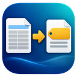
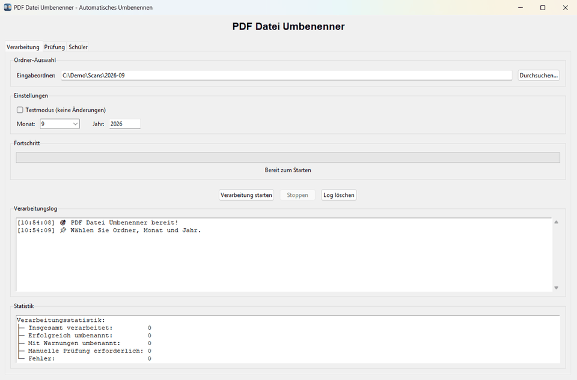
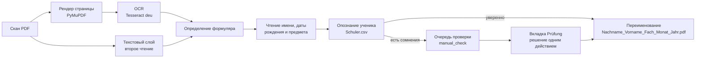

<p align="center">
  
</p>

<h1 align="center">PDF Datei Umbenenner</h1>

<p align="center">
  Автоматическое переименование отсканированных формуляров посещаемости по ученику, предмету и месяцу —<br>
  локальное распознавание, сверка с собственным справочником учеников и быстрая проверка для офисов на Windows.
</p>

<p align="center">
  
  
  
  
  
</p>

<p align="center">
  <a href="README.md">English</a> · <a href="README.de.md">Deutsch</a> · <b>Русский</b>
</p>



## Зачем

Учебные организации, работающие с Jobcenter, каждый месяц получают подписанный формуляр посещаемости на каждого ученика и предмет. Сканер сохраняет листы как `Scan_0001.pdf`, `Scan_0002.pdf`, … — и кому-то приходится открывать каждый файл, читать имя и предмет и переименовывать его, прежде чем документ можно подшить или выставить счёт. PDF Datei Umbenenner делает это автоматически:

```text
Scan_2026-09-30_0001.pdf  →  Beispiel_Lena_Mathematik_September_2026.pdf
Scan_2026-09-30_0002.pdf  →  Muster_Max_Deutsch_September_2026.pdf
Scan_2026-09-30_0006.pdf  →  проверка: новый ученик «Hoffmann Sophie» (дата рождения подставлена)
```

Если программа не уверена, она не угадывает: документ попадает в очередь проверки с готовым предложением, и оператор подтверждает его одним действием.

## Возможности

- **Два вида формуляров.** Формуляр посещаемости *Anwesenheitsnachweis* (с колонкой *GR/EZ* и без неё) и старый формуляр со строкой «Nachname Vorname Fach» в заголовке. Вид определяется по содержимому страницы, а не по имени файла.
- **Надёжное чтение реальных сканов.** Каждая страница распознаётся Tesseract OCR; текстовый слой сканера служит независимым вторым чтением. Подписи формуляра находятся и при типичных ошибках OCR, повёрнутые набок и вверх ногами страницы выравниваются, а записи колонки *GR/EZ* никогда не принимаются за предмет.
- **Аккуратное опознание ученика.** Имена сверяются с закрытым списком (`Schuler.csv`), необязательная дата рождения служит дополнительным ключом. Типичные путаницы OCR (`i/l/1`, `rn/m`, `o/a` …) исправляются только по строгому правилу; похожие и новые ученики всегда идут на проверку.
- **Проверка одним действием.** Вкладка *Prüfung* показывает фрагменты скана с именем, датой рождения и предметом, живой поиск ученика и готовые решения: принять предложенного ученика, создать нового с распознанными данными или добавить новый предмет.
- **Справочник учеников.** Редактирование, деактивация и поиск дублей, управление алиасами, импорт CSV с предпросмотром каждого изменения и автоматической резервной копией.
- **Безопасная работа с файлами.** Пробный прогон, атомарная запись, без перезаписи (суффиксы `_1`, `_2`), откат при частичных сбоях; ничего не удаляется.
- **Готово для офисных ПК.** `setup.bat` по согласию устанавливает Python (с проверкой подписи), проверяет Tesseract, создаёт ярлыки с иконкой программы и объясняет каждую ошибку понятным немецким текстом. Программа запускается без окна консоли и работает в одном экземпляре на установку.
- **Конфиденциальность по устройству.** Всё работает локально. Никакого облачного OCR и телеметрии; справочники, сканы и очередь проверки не покидают компьютер.

## Скриншоты

| Обработка папки | Проверка: новый ученик |
| --- | --- |
| [](docs/images/processing.png) | [](docs/images/review-new-student.png) |
| **Проверка: новый предмет у известного ученика** | **Справочник учеников** |
| [](docs/images/review-new-subject.png) | [](docs/images/students.png) |

На всех скриншотах — вымышленные демонстрационные данные из [`demo/`](demo/).

## Как это работает



Месяц и год всегда берутся из выбора оператора, а не из дат на формуляре. Подробнее: [как работает распознавание](docs/ru/how-it-works.md).

**Измерено на реальных сканах.** На 17 реальных сканах из повседневной работы (не публикуются) текущая версия принимает 12 правильных автоматических решений, **0 ошибочных** и отправляет на проверку 5 документов — все обоснованно, потому что 4 ученика ещё не были в справочнике. После их добавления автоматически переименовываются 17 из 17. Обработка занимает около 2–3 секунд на документ. Выборка мала, поэтому цифры — ориентир, а не гарантия.

## Быстрый старт

1. Скачайте репозиторий как ZIP, **разблокируйте его** (*Свойства → Разблокировать*) и распакуйте в локальную папку, например `C:\Users\<Имя>\PDF-Datei-Umbenenner` — не в OneDrive и не на сетевой диск.
2. Установите [Tesseract OCR](docs/ru/installation.md#2-установка-tesseract-ocr) с немецкими языковыми данными.
3. Скопируйте свой справочник `Schuler.csv` в папку программы (формат: `Nummer;Nachname;Vorname[;Geburtsdatum]`).
4. Дважды щёлкните `setup.bat`. Он при необходимости установит Python (после вопроса), создаст собственное окружение и предложит ярлыки на рабочем столе и в меню «Пуск».
5. Запустите **PDF Datei Umbenenner** с ярлыка, выберите папку со сканами, месяц и год и нажмите *Verarbeitung starten*.

Подробно: [установка и запуск](docs/ru/installation.md) · [руководство пользователя](docs/ru/user-guide.md)

## Демонстрация

В папке [`demo/`](demo/) — семь вымышленных сканов и соответствующий справочник. После `setup.bat`:

```cmd
.venv\Scripts\python.exe demo\run_demo.py
```

```text
Scan_2026-09-30_0001.pdf  -> Beispiel_Lena_Mathematik_September_2026.pdf
Scan_2026-09-30_0002.pdf  -> Muster_Max_Deutsch_September_2026.pdf
Scan_2026-09-30_0003.pdf  -> Schneider_Jonas_Englisch_September_2026.pdf
Scan_2026-09-30_0004.pdf  -> Weber_Mia_Biologie_September_2026.pdf
Scan_2026-09-30_0005.pdf  -> Probe_Paula_Physik_September_2026.pdf
Scan_2026-09-30_0006.pdf  -> Prüfung: Kein passender Schüler im Verzeichnis gefunden; vermutlich ein neuer Schüler. …
Scan_2026-09-30_0007.pdf  -> Prüfung: Unbekannte Fachwerte im Tabellenfeld: Latein; …
```

Скрипт работает с копией в `demo\output`; демонстрационные файлы и ваш собственный справочник не меняются. `--dry-run` только планирует имена.

| Формуляр посещаемости (*Anwesenheitsnachweis*) | Старый формуляр |
| --- | --- |
|  |  |

## Документация

| Тема | English | Deutsch | Русский |
| --- | --- | --- | --- |
| Установка, запуск, обновление, коды возврата | [installation](docs/en/installation.md) | [Installation](docs/de/installation.md) | [установка](docs/ru/installation.md) |
| Повседневная работа: обработка, проверка, справочник | [user guide](docs/en/user-guide.md) | [Benutzerhandbuch](docs/de/user-guide.md) | [руководство](docs/ru/user-guide.md) |
| Распознавание, правила опознания, сохранность данных | [how it works](docs/en/how-it-works.md) | [Funktionsweise](docs/de/how-it-works.md) | [как это работает](docs/ru/how-it-works.md) |
| CLI, API, тесты, стенд измерения | [development](docs/en/development.md) | [Entwicklung](docs/de/development.md) | [разработка](docs/ru/development.md) |

Интерфейс и сообщения программы — на немецком: она используется в немецких офисах.

## Персональные данные

Программа обрабатывает персональные данные учеников (имена, даты рождения) и устроена так, чтобы они оставались на компьютере, где их обрабатывают:

- OCR выполняется локально в Tesseract; файлы никуда не отправляются. Интернет нужен только при установке.
- Справочник (`Schuler.csv`, `Lehrer.csv`), выученные алиасы, очередь проверки и все сканы исключены из Git через [`.gitignore`](.gitignore).
- В тестах, документации и демонстрации используются только вымышленные имена. Пожалуйста, никогда не прикладывайте реальные сканы и справочники к issue.

## Структура проекта

```text
gui_main.py, start_gui.py        интерфейс Tkinter и точка входа для лаунчеров
processing_service.py            единый конвейер обработки для GUI и CLI
pdf_extractor.py, ocr.py         рендер страницы, Tesseract OCR, текстовый слой
form_parser.py, text_parser.py   определение формуляра и чтение полей
name_matching.py                 сравнение имён с учётом ошибок OCR
student_registry*.py             справочник, алиасы, опознание, импорт CSV
review_*.py                      очередь проверки, решения, фрагменты скана
file_renamer.py, validator.py    безопасное переименование и проверка предмета
desktop_integration.py           один экземпляр, иконка, размер окна (Windows)
setup.bat, start_app.bat, …      установка и лаунчеры, проверки в bootstrap.py
demo/                            вымышленные сканы, справочник и демо-скрипт
tools/evaluate_recognition.py    стенд измерения на папке реальных сканов
tests/                           набор pytest (модули, GUI, лаунчеры в cmd.exe, OCR)
```

## Разработка

```cmd
.venv\Scripts\python.exe -m pip install -r requirements-dev.txt
.venv\Scripts\python.exe -m pytest
```

Тесты проверяют конвейер, интерфейс на реальных виджетах Tk, BAT-лаунчеры в настоящем `cmd.exe` и сквозной прогон OCR на демонстрационных сканах (пропускается без Tesseract). Архитектура, CLI и стенд измерения: [разработка](docs/ru/development.md).

## Лицензия

Исходный код распространяется по [лицензии MIT](LICENSE). © 2025–2026 Konstantin Shakun.

Сторонние компоненты сохраняют свои лицензии: [PyMuPDF](https://pymupdf.readthedocs.io/) распространяется компанией Artifex по двойной лицензии — **AGPL-3.0** или коммерческой. Он устанавливается отдельно через `pip`; при распространении программы вместе с PyMuPDF на такое распространение действуют условия AGPL. pdfplumber, pdfminer.six и Pillow — под лицензиями типа MIT, pypdfium2 — Apache-2.0/BSD-3-Clause, [Tesseract OCR](https://github.com/tesseract-ocr/tesseract) — Apache-2.0.
