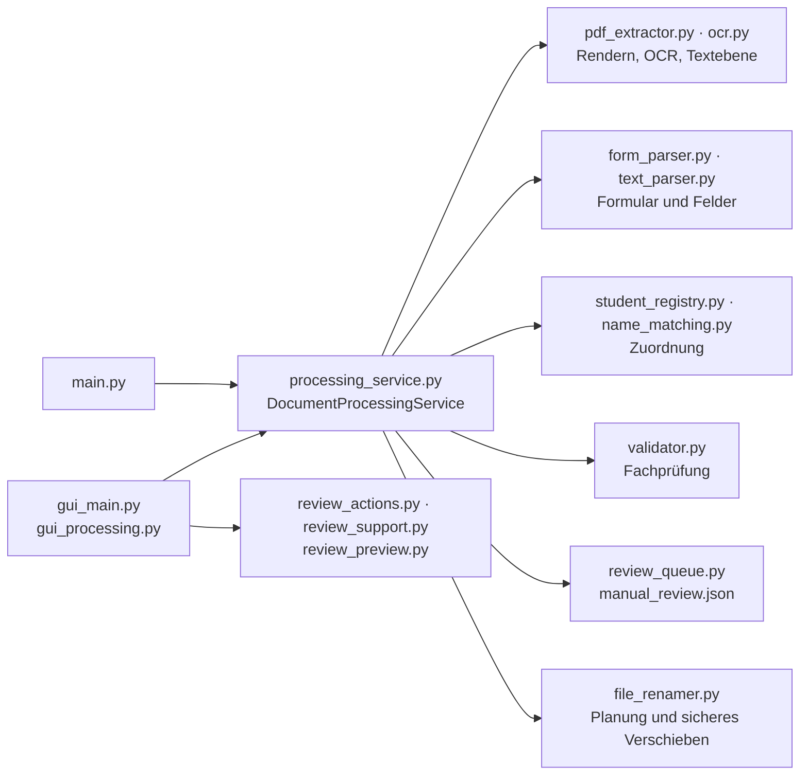

# Entwicklung

[English](../en/development.md) · **Deutsch** · [Русский](../ru/development.md) · [← README](../../README.de.md)

- [Umgebung](#umgebung)
- [Architektur](#architektur)
- [Kommandozeile](#kommandozeile)
- [Python-API](#python-api)
- [Tests](#tests)
- [Zustandsprüfungen](#zustandsprüfungen)
- [Messstand](#messstand)
- [Demodaten](#demodaten)
- [Konventionen](#konventionen)

## Umgebung

Das Programm richtet sich an Windows (Tkinter-Oberfläche, BAT-Starter) und Python 3.10–3.15. Nachdem `setup.bat` die `.venv` angelegt hat:

```cmd
.venv\Scripts\python.exe -m pip install -r requirements-dev.txt
.venv\Scripts\python.exe -m pytest
```

`requirements.txt` enthält die Laufzeitabhängigkeiten (`pdfplumber`, `PyMuPDF`, `Pillow`), `requirements-dev.txt` ergänzt `pytest`. Tesseract OCR mit `deu` wird für die echten OCR-Tests und die Verarbeitung benötigt.

## Architektur

Es gibt genau eine Verarbeitungskette. Oberfläche und Kommandozeile nutzen beide `DocumentProcessingService`; ältere Einstiegspunkte (`gui_minimal.py`, `processing_pipeline.py`) sind dünne Kompatibilitäts-Aliasse.



| Modul | Aufgabe |
| --- | --- |
| `pdf_extractor.py`, `ocr.py`, `page_data.py` | Textebene, Rendern der Seite (PyMuPDF), Tesseract-Aufrufe mit Zeitlimits, Ausrichtungserkennung, Feld-OCR |
| `form_parser.py`, `text_parser.py` | Formularerkennung, tolerante Suche nach Beschriftungen, Lesen von Name/Geburtsdatum/Fach, Belege je Feld |
| `name_matching.py` | Gewichteter, OCR-gerechter Namensvergleich und Vergleich von Geburtsdaten |
| `student_registry.py`, `student_registry_service.py` | Verzeichnis, Aliasnamen, Zuordnung, Bearbeitung, CSV-Import mit Vorschau |
| `processing_service.py` | Steuerung der Kette, Entscheidungen, Planung des Durchlaufs, Rücksetzen |
| `review_queue.py`, `review_actions.py`, `review_support.py`, `review_preview.py` | Dauerhafte Prüfliste, Entscheidungen, Suchreihenfolge, Scan-Ausschnitte |
| `file_renamer.py`, `validator.py`, `alias_manager.py` | Kollisionsfreies Umbenennen, Fachprüfung, Fach-Aliasnamen |
| `gui_main.py`, `gui_processing.py`, `start_gui.py`, `desktop_integration.py` | Tkinter-Oberfläche, Durchlauf im Hintergrund, Startpunkt für die Starter, Windows-Anbindung |
| `bootstrap.py`, `*.bat`, `install_*.ps1` | Zustandsprüfungen, Einrichtung der Umgebung, Starter, signierte Installer |

## Kommandozeile

Die Kommandozeile verlangt ausdrücklich Monat und Jahr:

```cmd
.venv\Scripts\python.exe main.py C:\Scans\2026-09 --month 9 --year 2026
.venv\Scripts\python.exe main.py C:\Scans\2026-09 --month 9 --year 2026 --dry-run
```

`--tesseract-path` legt die Tesseract-Datei ausdrücklich fest; ohne Ordner startet `main.py` die Oberfläche. Die Kommandozeile schreibt Prüfliste und Ordner `manual_check` in den verarbeiteten Ordner. Ein Fehler bei einem einzelnen PDF hält den Durchlauf nicht an.

| Rückgabecode | Bedeutung |
| --- | --- |
| `0` | Durchlauf abgeschlossen |
| `2` | Fehler bei der Verarbeitung oder beim Speichern der Prüfliste |
| `3` | OCR nicht verfügbar — die Verarbeitung hat nicht begonnen |

## Python-API

```python
from pathlib import Path
from main import build_processing_service

folder = Path(r"C:\Scans\2026-09")
service = build_processing_service(folder, registry_csv=Path("Schuler.csv"))
batch = service.process_batch(sorted(folder.glob("*.pdf")), month=9, year=2026, dry_run=True)
for result in batch.results:
    print(result.pdf_path.name, result.planned_action.value, result.planned_name)
```

- `process_document(path, month, year, dry_run=False)` liefert ein `ProcessingResult` mit den abgeschlossenen Stufen, den gelesenen und kanonischen Daten, der Schülerzuordnung, der Fachprüfung, Hinweisen, der geplanten Aktion (`rename` / `manual_review`), dem geplanten Namen und Pfad, dem Prüfeintrag und — bei Fehlern — `error`, `failed_stage` und `actual_path`.
- `process_batch(paths, month, year, dry_run=False)` beginnt eine neue Reservierung von Namen und liefert ein `BatchProcessingResult`.
- Die Abhängigkeiten (Extraktor, Parser, Verzeichnis, Validator, Prüfliste, Umbenenner) werden dem Konstruktor übergeben; so lässt sich der Dienst gut testen.

Verzeichnis (`student_registry.StudentRegistry`), unabhängig von der Oberfläche:

- `identify(NameEvidence(...))` — Entscheidung aus allen Lesungen und dem Geburtsdatum: `exact`, `auto_corrected`, `ambiguous`, `unknown` oder `error`, mit geordneten Kandidaten und einem Vorschlag für einen neuen Schüler;
- `match(raw_name)` / `match_parts(last_name, first_name)` — strenger Abgleich eines einzelnen Namens;
- Änderungen nur über ausdrückliche Aufrufe: `confirm_existing(raw_name, number, save_alias=True)`, `confirm_new(last_name, first_name, birth_date=None)`, `update_student(number, ...)`, `learn_birth_date(number, date)`. Fehler werden als `RegistryValidationError`, `RegistryUnavailableError` oder `RegistryWriteError` gemeldet.

## Tests

Die pytest-Suite (etwa 550 Tests, 2–3 Minuten) prüft:

- die Verarbeitungskette mit simulierter OCR für Ablauf und Fehlerfälle — Rücksetzen, Kollisionen, beschädigte Dateien, Zeitüberschreitungen;
- das Lesen der Formulare, die Zuordnungsregeln und Negativfälle: Namensvettern, Geschwister, ähnliche neue Schüler, widersprüchliche Lesungen und Geburtsdaten, widersprüchliche und unbekannte Fächer;
- die Oberfläche mit echten Tk-Widgets (Prüfung, Verzeichnis, Anordnung auf kleinen Bildschirmen);
- die BAT-Starter in einem echten `cmd.exe` mit simulierten Hilfsprogrammen: Pfade mit Leerzeichen, `&`, `!`, Umlauten; Pausen; UNC und OneDrive; die Python-Installation; Verknüpfungen;
- `install_python.ps1` ohne Netz (Download-Fehler, unsignierte und falsch signierte Dateien);
- echtes Tesseract an synthetischen Formularen, auch an gedrehten Seiten, und einen vollständigen Durchlauf mit den Demo-Scans.

Tests, die Windows, eine Anzeige für Tk oder Tesseract brauchen, werden ohne diese automatisch übersprungen. Tests verwenden nur erfundene Daten.

## Zustandsprüfungen

```cmd
.venv\Scripts\python.exe bootstrap.py check-packages
.venv\Scripts\python.exe bootstrap.py check-core
.venv\Scripts\python.exe bootstrap.py check-ocr
```

`check-packages` importiert nur die Pflichtpakete, `check-core` prüft zusätzlich tkinter, die Programmimporte und die Datendateien, `check-ocr` prüft Tesseract und die Sprachdaten. Sie liefern die [Rückgabecodes](installation.md#rückgabecodes) der Starter.

## Messstand

`tools/evaluate_recognition.py` misst die Erkennungsqualität an einem Ordner echter Scans — immer als Testlauf ohne Änderungen:

```cmd
.venv\Scripts\python.exe tools\evaluate_recognition.py Scans --month 9 --year 2026
.venv\Scripts\python.exe tools\evaluate_recognition.py <Ordner umbenannter PDFs> --from-filenames
```

Als Referenz dient entweder `_expected.csv` im Scan-Ordner (`Datei;Nachname;Vorname;Fach`) oder die Namen bereits umbenannter PDFs. Der Messstand zählt richtige und **falsche** automatische Entscheidungen, berechtigte Prüfungen (Schüler oder Fach nicht in den Listen), unnötige Prüfungen, Fehler und die Zeit je Dokument. `--registry` setzt ein anderes Verzeichnis ein (z. B. eine temporäre Kopie), `--report` speichert eine Tabelle. Vor und nach dem Lauf werden die SHA-256-Werte aller PDFs und Datendateien verglichen.

Rückgabecodes: `0` keine falschen Entscheidungen, `1` falsche automatische Entscheidungen, `2` Fehler in Parametern oder Referenz, `3` Daten haben sich während des Laufs geändert. Referenz und Berichte enthalten Namen; `_expected.csv` und `recognition_report*` sind deshalb von Git ausgeschlossen.

## Demodaten

[`demo/`](../../demo/) enthält sieben erfundene Scans, ein passendes Verzeichnis und zwei Skripte:

- `demo/make_demo_scans.py` erzeugt die Scans neu (Anwesenheitsnachweis mit und ohne *GR/EZ*, älteres Formular, eine kopfüber gescannte Seite, ein neuer Schüler und ein neues Fach);
- `demo/run_demo.py` verarbeitet eine Kopie in `demo/output` (`--dry-run`, `--month`, `--year`, `--output`). Der Test `tests/test_demo_scans.py` stellt sicher, dass die dokumentierten Ergebnisse stimmen.

## Konventionen

- Eine Verarbeitungskette für Oberfläche und Kommandozeile; kein Einstiegspunkt bekommt eigene Erkennungsregeln.
- Meldungen von Oberfläche, Kommandozeile und Startern sind deutsch. BAT-Dateien sind ASCII mit CRLF-Zeilenenden (`ae/oe/ue` statt Umlauten).
- Neue direkte Abhängigkeiten gehören in derselben Änderung in die passende Requirements-Datei.
- Personenbezogene Daten gelangen nie ins Repository: keine echten Namen, Geburtsdaten, BG-Nummern oder OCR-Texte echter Scans in Tests, Fixtures, Dokumentation oder Issues.
- Eine falsche automatische Entscheidung ist schlimmer als eine Prüfung: Neue Heuristiken brauchen Negativtests (Namensvettern, ähnliche Namen, Widersprüche) und einen Lauf des Messstands mit **0 falschen Entscheidungen**.
