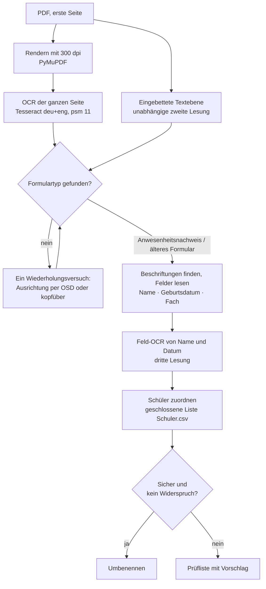

# Funktionsweise der Erkennung

[English](../en/how-it-works.md) · **Deutsch** · [Русский](../ru/how-it-works.md) · [← README](../../README.de.md)

Der Leitgedanke: **Ein falsches automatisches Umbenennen ist schlimmer als eine zusätzliche Prüfung.** Jeder Schritt sammelt deshalb Belege, und ein Dokument wird nur dann automatisch umbenannt, wenn nichts dem Ergebnis widerspricht. Im Zweifel kommt es in die Prüfung — mit einem vorbereiteten Vorschlag.

## 1. Die Seite lesen

Scanner legen oft eine Textebene an, doch bei echten Büro-Scans ist sie stark beschädigt („Anwosenheitsnochweis“, kyrillische Buchstaben mitten in deutschen Wörtern). Deshalb führt das Programm **für jedes Dokument eine Texterkennung** durch:

- die erste Seite wird mit PyMuPDF in 300 dpi gerendert, unter Beachtung der im PDF gespeicherten Seitendrehung;
- Tesseract liest sie mit den Sprachen `deu` und `eng` und dem Seitensegmentierungsmodus 11 (verstreuter Text). Messungen an echten Scans zeigten, dass der Standardmodus 3 auf manchen Seiten die Spalte *Fach* der Tabelle verliert;
- die Textebene des Scanners bleibt als **unabhängige zweite Lesung** erhalten und dient als Rückfallebene, falls die OCR für ein Dokument scheitert;
- wird in keiner Lesung eine Formularstruktur gefunden, wird die Seite einmal erneut gelesen — gedreht um den Winkel aus der Ausrichtungserkennung von Tesseract (`osd`), sonst kopfüber. Der Versuch wird nur übernommen, wenn er ein Formular zeigt;
- jeder Aufruf von Tesseract hat ein Zeitlimit (120 s für die Erkennung, 20 s für Abfragen). Eine gescheiterte oder abgebrochene OCR schickt das Dokument mit Diagnose in die Prüfung.

Zwei gleiche Ergebnisse unterschiedlicher OCR-Einstellungen desselben Bildes zählen nicht als unabhängige Belege; die OCR des Bildes und die Textebene des Scanners schon.

## 2. Das Formular erkennen

Der Formulartyp wird an gedruckten Beschriftungen erkannt, die mit einer Toleranz für typische OCR-Fehler verglichen werden — etwa ein Viertel der Buchstaben darf abweichen (*Anwesenheitsnachweis* bis zu 5 Fehler, *Geburtsdatum* 3, *Fach* und *Dauer* 1); kurze Beschriftungen wie *Ort* müssen genau passen. Kyrillische und andere ähnlich aussehende Buchstaben werden vorher vereinheitlicht.

| Formular | Beschriftungen | Entscheidung |
| --- | --- | --- |
| Anwesenheitsnachweis | *Anwesenheitsnachweis*, *Name des Schülers*, *Fach*, *Name der Lehrkraft* | mindestens 3 von 4 |
| Älteres Formular | *Bewilligungszeitraum*, *Monat*, *Unterrichtsart*, *Lehrer(in)* | mindestens 2 von 4 |

## 3. Die Felder lesen

- **Name** (Anwesenheitsnachweis): die Zeile über *Name des Schülers*, links von *Geburtsdatum*. Kurze Bruchstücke von Unterschriften werden ignoriert; eine Zeile mit Ziffern oder Zeichen in längeren Wörtern ist unplausibel. Beim älteren Formular stammt der Name aus der Kopfzeile.
- **Geburtsdatum:** Formate wie `14.03.2013` und typische OCR-Varianten (`1403 2013`, `1O` → `10`), nur bei plausiblem Alter von 2–30 Jahren übernommen. Ein fehlendes Datum blockiert nie.
- **Dritte Lesung:** Die Bereiche von Name und Geburtsdatum werden ausgeschnitten und erneut als einzelne Zeile erkannt. So gibt es für jedes Feld bis zu drei Lesungen — Seiten-OCR, Feld-OCR und Textebene.
- **Fach:** Die Spalte *Fach* wird durch ihre Nachbarn begrenzt (*GR/EZ* oder *Dauer* links, *Ort* rechts). Werte der Spalte *GR/EZ* und ihre OCR-Varianten werden verworfen. Jede Zeile wird mit dem Fächerkatalog verglichen (kanonische Fächer, Abkürzungen und bestätigte Aliasnamen); ein falsch gelesenes Wort mit mindestens 5 Buchstaben darf mit bis zu einem Viertel falscher Buchstaben einem Fach zugeordnet werden, aber nur, wenn kein anderes Fach gleich nah ist. Es entscheidet die übereinstimmende Mehrheit der Zeilen. Ein unbekanntes Wort, das in zwei oder mehr Zeilen steht, wird zum **Fachvorschlag** für die Prüfung.
- Eine fehlende Nachbarbeschriftung (*Dauer*, *Ort*, *Name der Lehrkraft*, *Geburtsdatum*) erzeugt nur einen Hinweis, wenn das Feld trotzdem gefunden wurde und sein Inhalt übereinstimmt (dasselbe Fach in mindestens drei Zeilen); sonst blockiert sie.

Für jedes Feld speichert die Prüfliste die Belege: alle Lesungen, die Position auf der Seite (für die Scan-Ausschnitte in der Prüfung) und die Gründe für Zweifel.

## 4. Den Schüler zuordnen

Das Verzeichnis ist eine **geschlossene Liste**: Das Programm entscheidet nur zwischen Schülern, die in `Schuler.csv` stehen.

1. **Exakte Übereinstimmung.** Gleicht eine Lesung dem Namen eines Schülers oder einem bestätigten Alias (in beiden Namensreihenfolgen), wird dieser Schüler übernommen — außer eine andere Lesung zeigt deutlich auf einen anderen Schüler oder das Geburtsdatum widerspricht.
2. **Automatische OCR-Korrektur**, nur wenn *alle* Bedingungen erfüllt sind:
   - das Namensfeld wurde über die Formularstruktur gefunden;
   - die Lesung weicht von genau einem Schüler nur durch typische OCR-Verwechslungen gedruckter Schrift ab;
   - Ähnlichkeit ≥ 0,85, jeder Namensteil ≥ 0,75 und ein Vorsprung von ≥ 0,25 vor dem nächsten Kandidaten;
   - nichts widerspricht — insbesondere gelten unabhängige Lesungen, die übereinstimmend eine Schreibweise mit echten Abweichungen zeigen, als Widerspruch.

   Bei übereinstimmendem gespeichertem Geburtsdatum genügen Ähnlichkeit ≥ 0,70, jeder Teil ≥ 0,55 und höchstens zwei echte Abweichungen.
3. **Widersprechendes Geburtsdatum.** Ein sicher gelesenes Geburtsdatum, das vom Verzeichnis abweicht, verhindert eine automatische Entscheidung selbst bei exaktem Namen. Eine einzelne Verwechslung ähnlicher Ziffern (0/6, 0/8, 6/8, 3/8, 5/6, 3/5, 1/7, 1/4) gilt als „nah“, nicht als Widerspruch.
4. **Neuer Schüler.** Liegt die beste Ähnlichkeit unter 0,70, kommt das Dokument als *vermutlich ein neuer Schüler* mit einem Vorschlag (Nachname, Vorname, Geburtsdatum) in die Prüfung.

Die Ähnlichkeit ist ein gewichteter Editierabstand. Typische OCR-Verwechslungen kosten 0,3 statt 1: `i/l/1/j`, `l/t`, `t/f`, `f/l`, `o/a`, `o/0`, `e/c`, `u/n`, `n/h`, `h/b`, `m/n`, `s/5`, `b/8`, `g/9`, `z/2` und die Gruppen `rn/m`, `cl/d`, `vv/w`, `ii/u`, `ri/n`. Paare wie `a/e` oder `o/e` sind bewusst **nicht** günstig: *Anna* und *Anne* können zwei verschiedene Personen sein.

Automatische Korrekturen werden im Ergebnis vermerkt (was gelesen wurde, welcher Schüler gewählt wurde); sie legen nie Aliasnamen an und lernen nie Geburtsdaten. Ein Geburtsdatum wird nur nach erfolgreichem Umbenennen bei exakter Übereinstimmung und sauber gelesenem Datum übernommen.

## 5. Benennung und Dateisicherheit

- Dateinamen bestehen aus dem kanonischen Nachnamen und Vornamen aus dem Verzeichnis, dem kanonischen Fach und dem gewählten Zeitraum.
- Zielnamen werden geplant, bevor etwas verschoben wird: Vorhandene Dateien und im Durchlauf bereits vergebene Namen gelten als belegt, gewählt wird der erste freie Zusatz `_1`, `_2`, … Testmodus und echter Durchlauf ergeben denselben Plan.
- CSV- und JSON-Dateien werden über eine temporäre Datei, `fsync` und atomares Ersetzen geschrieben. Schlägt sogar das Aufräumen fehl, werden beide Fehler und der Pfad der temporären Datei gemeldet.
- Lässt sich die Prüfliste nicht speichern, versucht das Programm, das PDF an seinen ursprünglichen Ort zurückzulegen, und meldet den Fehler ausdrücklich. Kann beim Verschieben zwischen Laufwerken die Quelle nicht gelöscht werden, wird die Kopie wieder entfernt; gelingt auch das nicht, werden beide Pfade gemeldet.
- Eine beschädigte Prüfliste oder Aliasdatei wird „fail-closed“ geöffnet: Das Programm meldet den Fehler, statt die Datei durch eine leere zu ersetzen.
- Es wird nie etwas gelöscht; ein Fehler bei einem PDF hält den Durchlauf nicht an.

## 6. Grenzen

- Gelesen wird nur die erste Seite.
- Name und Fach sollten gedruckt sein. Handschriftliche Einträge sind selten und landen meist in der Prüfung; eine Handschrifterkennung gibt es nicht.
- Die Schwellwerte wurden an 17 echten Scans und an synthetischen Tests gewählt. Sie sind eine begründete Einstellung, keine statistische Garantie — deshalb gehen unsichere Fälle immer in die Prüfung.
