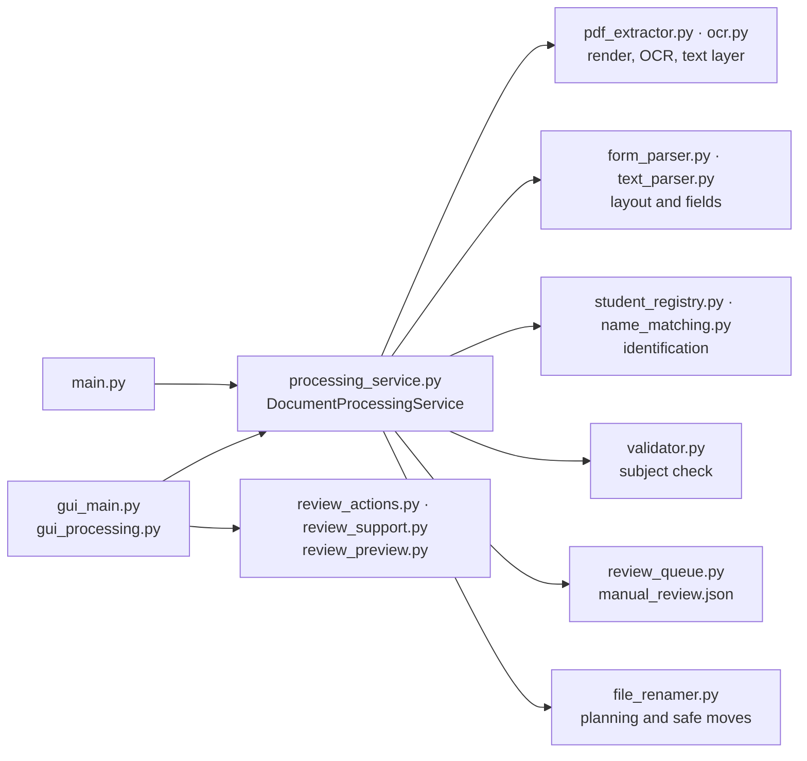

# Development

**English** · [Deutsch](../de/development.md) · [Русский](../ru/development.md) · [← README](../../README.md)

- [Environment](#environment)
- [Architecture](#architecture)
- [Command line](#command-line)
- [Python API](#python-api)
- [Tests](#tests)
- [Health checks](#health-checks)
- [Measurement stand](#measurement-stand)
- [Demo data](#demo-data)
- [Conventions](#conventions)

## Environment

The application targets Windows (Tkinter GUI, BAT launchers) and Python 3.10–3.15. After `setup.bat` has created `.venv`:

```cmd
.venv\Scripts\python.exe -m pip install -r requirements-dev.txt
.venv\Scripts\python.exe -m pytest
```

`requirements.txt` holds the runtime dependencies (`pdfplumber`, `PyMuPDF`, `Pillow`), `requirements-dev.txt` adds `pytest`. Tesseract OCR with `deu` is needed for the real OCR tests and for processing.

## Architecture

There is exactly one processing pipeline. The GUI and the CLI both use `DocumentProcessingService`; older entry points (`gui_minimal.py`, `processing_pipeline.py`) are thin compatibility aliases.



| Module | Responsibility |
| --- | --- |
| `pdf_extractor.py`, `ocr.py`, `page_data.py` | Text layer extraction, page rendering (PyMuPDF), Tesseract calls with timeouts, orientation detection, field OCR |
| `form_parser.py`, `text_parser.py` | Layout detection, tolerant label search, name/birth date/subject reading, evidence per field |
| `name_matching.py` | Weighted, OCR-aware name comparison and birth date comparison |
| `student_registry.py`, `student_registry_service.py` | Registry, aliases, identification, CRUD, CSV import with preview |
| `processing_service.py` | Pipeline orchestration, decisions, batch planning, rollback |
| `review_queue.py`, `review_actions.py`, `review_support.py`, `review_preview.py` | Durable review queue, operator decisions, search ranking, scan fragments |
| `file_renamer.py`, `validator.py`, `alias_manager.py` | Collision-free renaming, subject validation, subject aliases |
| `gui_main.py`, `gui_processing.py`, `start_gui.py`, `desktop_integration.py` | Tkinter interface, background batch worker, launcher entry point, Windows integration |
| `bootstrap.py`, `*.bat`, `install_*.ps1` | Health checks, environment setup, launchers, signed installers |

## Command line

The CLI needs an explicit month and year:

```cmd
.venv\Scripts\python.exe main.py C:\Scans\2026-09 --month 9 --year 2026
.venv\Scripts\python.exe main.py C:\Scans\2026-09 --month 9 --year 2026 --dry-run
```

`--tesseract-path` sets the Tesseract executable explicitly; without a folder, `main.py` starts the GUI. The CLI writes the review queue and the `manual_check` folder into the processed folder. An error in a single PDF does not stop the batch.

| Exit code | Meaning |
| --- | --- |
| `0` | Batch finished |
| `2` | Processing or queue-saving errors occurred |
| `3` | OCR not available — processing did not start |

## Python API

```python
from pathlib import Path
from main import build_processing_service

folder = Path(r"C:\Scans\2026-09")
service = build_processing_service(folder, registry_csv=Path("Schuler.csv"))
batch = service.process_batch(sorted(folder.glob("*.pdf")), month=9, year=2026, dry_run=True)
for result in batch.results:
    print(result.pdf_path.name, result.planned_action.value, result.planned_name)
```

- `process_document(path, month, year, dry_run=False)` returns a `ProcessingResult` with the completed stages, the extracted and canonical data, the student match, the subject validation, warnings, the planned action (`rename` / `manual_review`), the planned name and path, the review item and — on failure — `error`, `failed_stage` and `actual_path`.
- `process_batch(paths, month, year, dry_run=False)` starts a new batch of name reservations and returns a `BatchProcessingResult`.
- The dependencies (extractor, parser, registry, validator, review store, renamer) are passed to the constructor, which makes the service easy to test.

Registry (`student_registry.StudentRegistry`), independent of the GUI:

- `identify(NameEvidence(...))` — decision from all readings and the birth date: `exact`, `auto_corrected`, `ambiguous`, `unknown` or `error`, with ranked candidates and a new-student proposal;
- `match(raw_name)` / `match_parts(last_name, first_name)` — strict matching of a single name;
- changes only through explicit calls: `confirm_existing(raw_name, number, save_alias=True)`, `confirm_new(last_name, first_name, birth_date=None)`, `update_student(number, ...)`, `learn_birth_date(number, date)`. Errors are raised as `RegistryValidationError`, `RegistryUnavailableError` or `RegistryWriteError`.

## Tests

The pytest suite (about 550 tests, 2–3 minutes) covers:

- the pipeline with fake OCR for control flow and failures — rollback, collisions, damaged files, timeouts;
- form reading, identification rules and negative cases: namesakes, siblings, similar new students, contradicting readings and birth dates, conflicting and unknown subjects;
- the GUI on real Tk widgets (review window, registry, layout on small screens);
- the BAT launchers in a real `cmd.exe` with stubbed helpers: paths with spaces, `&`, `!`, umlauts; pauses; UNC and OneDrive; the Python installation branch; shortcuts;
- `install_python.ps1` offline (download errors, unsigned and wrongly signed files);
- real Tesseract on synthetic forms, including rotated pages, and an end-to-end run on the demo scans.

Tests that need Windows, a display for Tk or Tesseract are skipped automatically when these are missing. Tests use invented data only.

## Health checks

```cmd
.venv\Scripts\python.exe bootstrap.py check-packages
.venv\Scripts\python.exe bootstrap.py check-core
.venv\Scripts\python.exe bootstrap.py check-ocr
```

`check-packages` imports only the required packages, `check-core` additionally checks tkinter, the application imports and the data files, `check-ocr` checks Tesseract and the language data. They return the [exit codes](installation.md#exit-codes) used by the launchers.

## Measurement stand

`tools/evaluate_recognition.py` measures recognition quality on a folder of real scans — always as a dry run:

```cmd
.venv\Scripts\python.exe tools\evaluate_recognition.py Scans --month 9 --year 2026
.venv\Scripts\python.exe tools\evaluate_recognition.py <folder of renamed PDFs> --from-filenames
```

The reference is either `_expected.csv` in the scan folder (`Datei;Nachname;Vorname;Fach`) or the names of already renamed PDFs. The stand counts correct and **wrong** automatic decisions, justified reviews (student or subject not in the lists), unnecessary reviews, errors and the time per document. `--registry` substitutes another registry (for example a temporary copy), `--report` saves a table. It compares the SHA-256 of all PDFs and data files before and after the run.

Exit codes: `0` no wrong decisions, `1` wrong automatic decisions, `2` parameter or reference error, `3` data changed during the run. The reference and the reports contain names, so `_expected.csv` and `recognition_report*` are excluded from Git.

## Demo data

[`demo/`](../../demo/) contains seven fictional scans, a matching registry and two scripts:

- `demo/make_demo_scans.py` regenerates the scans (attendance record with and without *GR/EZ*, older layout, an upside-down page, a new student and a new subject);
- `demo/run_demo.py` processes a copy in `demo/output` (`--dry-run`, `--month`, `--year`, `--output`). The test `tests/test_demo_scans.py` keeps the documented results true.

## Conventions

- One pipeline for GUI and CLI; no entry point gets its own recognition rules.
- Messages of the GUI, CLI and launchers are German. BAT files are ASCII with CRLF line endings (`ae/oe/ue` instead of umlauts).
- New direct dependencies go into the right requirements file in the same change.
- Personal data never enters the repository: no real names, birth dates, BG numbers or OCR text of real scans in tests, fixtures, documentation or issues.
- A wrong automatic decision is worse than a review: new heuristics need negative tests (namesakes, similar names, contradictions) and a run of the measurement stand with **0 wrong decisions**.
