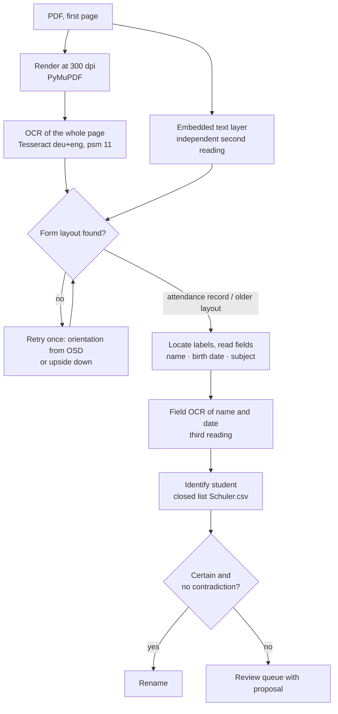

# How recognition works

**English** · [Deutsch](../de/how-it-works.md) · [Русский](../ru/how-it-works.md) · [← README](../../README.md)

The guiding principle: **a wrong automatic rename is worse than an extra review.** Every step therefore collects evidence, and a document is renamed automatically only when nothing contradicts the result. When in doubt, it goes to review — with a prepared proposal.

## 1. Reading the page

Scanners often add a text layer, but on real office scans it is badly damaged ("Anwosenheitsnochweis", Cyrillic letters inside German words). The program therefore **runs OCR on every document**:

- the first page is rendered with PyMuPDF at 300 dpi, honouring the page rotation stored in the PDF;
- Tesseract reads it with the languages `deu` and `eng` and page segmentation mode 11 (sparse text). Measurements on real scans showed that the default mode 3 loses the *Fach* column of the table on some pages;
- the scanner's text layer is kept as an **independent second reading** and as a fallback when OCR fails for a document;
- if no form structure is found in any reading, the page is read once more — rotated by the angle reported by Tesseract's orientation detection (`osd`), otherwise upside down. The retry is accepted only if it reveals a form;
- each Tesseract call has a time limit (120 s for recognition, 20 s for queries). A failed or timed-out OCR sends the document to review with a diagnosis.

Two identical results of different OCR settings on the same image are not counted as independent evidence; OCR of the image and the scanner's text layer are.

## 2. Detecting the form

The layout is recognised from printed labels, which are matched with a tolerance for typical OCR errors — about a quarter of the letters may differ (*Anwesenheitsnachweis* up to 5 errors, *Geburtsdatum* 3, *Fach* and *Dauer* 1), short labels such as *Ort* must match exactly. Cyrillic and other look-alike letters are normalised first.

| Layout | Labels | Decision |
| --- | --- | --- |
| Attendance record | *Anwesenheitsnachweis*, *Name des Schülers*, *Fach*, *Name der Lehrkraft* | at least 3 of 4 |
| Older layout | *Bewilligungszeitraum*, *Monat*, *Unterrichtsart*, *Lehrer(in)* | at least 2 of 4 |

## 3. Reading the fields

- **Name** (attendance record): the line above *Name des Schülers*, left of *Geburtsdatum*. Short fragments of signatures are ignored; a line with digits or symbols inside longer words is implausible. On the older layout, the name comes from the header line.
- **Birth date:** formats such as `14.03.2013` and typical OCR variants (`1403 2013`, `1O` → `10`), accepted only for a plausible age of 2–30 years. A missing date never blocks.
- **Third reading:** the regions of name and birth date are cut out and read again by OCR as a single line, so up to three readings exist for each field — page OCR, field OCR and the text layer.
- **Subject:** the *Fach* column is bounded by its neighbours (*GR/EZ* or *Dauer* on the left, *Ort* on the right). Values of the *GR/EZ* column and their OCR variants are discarded. Each row is matched against the subject catalogue (canonical subjects, abbreviations and confirmed aliases); a misread word of at least 5 letters may match one subject with up to a quarter of the letters wrong, but only if no other subject is equally close. The consistent majority of rows decides. An unknown word printed in two or more rows becomes a **subject proposal** for the review.
- A missing neighbour label (*Dauer*, *Ort*, *Name der Lehrkraft*, *Geburtsdatum*) only produces a note if the field was still found and its content is consistent (the same subject in at least three rows); otherwise it blocks.

For every field the queue stores the evidence: all readings, the position on the page (used for the scan fragments in the review tab) and the reasons for doubt.

## 4. Identifying the student

The registry is a **closed list**: the program only decides between students that exist in `Schuler.csv`.

1. **Exact match.** If any reading equals a student's name or a confirmed alias (both name orders), that student is taken — unless another reading points strongly to a different student or the birth date contradicts.
2. **Automatic OCR correction**, only if *all* conditions hold:
   - the name field was located by the form structure;
   - the reading differs from one student only by typical OCR confusions of printed text;
   - similarity ≥ 0.85, every name part ≥ 0.75, and a lead of ≥ 0.25 over the next candidate;
   - nothing contradicts — in particular, independent readings that agree on a spelling with real differences count as a contradiction.

   With a matching stored birth date the rule is relaxed to similarity ≥ 0.70, every part ≥ 0.55 and at most two real differences.
3. **Contradicting birth date.** A confidently read birth date that differs from the registry forbids an automatic decision, even for an exact name. A single confusion of similar digits (0/6, 0/8, 6/8, 3/8, 5/6, 3/5, 1/7, 1/4) counts as "near", not as a contradiction.
4. **New student.** If the best similarity is below 0.70, the document goes to review as *vermutlich ein neuer Schüler* with a proposal (surname, first name, birth date).

Similarity is a weighted edit distance. Typical OCR confusions cost 0.3 instead of 1: `i/l/1/j`, `l/t`, `t/f`, `f/l`, `o/a`, `o/0`, `e/c`, `u/n`, `n/h`, `h/b`, `m/n`, `s/5`, `b/8`, `g/9`, `z/2` and the groups `rn/m`, `cl/d`, `vv/w`, `ii/u`, `ri/n`. Pairs such as `a/e` or `o/e` are deliberately **not** cheap: *Anna* and *Anne* may be two different people.

Automatic corrections are marked in the result (what was read, which student was chosen); they never create aliases and never teach birth dates. A birth date is learned only after a successful rename with an exact match and a clean reading of the date.

## 5. Naming and file safety

- File names use the canonical surname and first name from the registry, the canonical subject and the selected period.
- Target names are planned before anything is moved: existing files and names reserved earlier in the batch count as taken, and the first free suffix `_1`, `_2`, … is chosen. A dry run and the real run produce identical plans.
- CSV and JSON files are written via a temporary file, `fsync` and an atomic replacement. If even the cleanup fails, both errors and the path of the temporary file are reported.
- If saving the review queue fails, the program tries to move the PDF back to its original place and reports the failure explicitly. A move between drives that cannot delete the source removes the copy again; if that fails too, both paths are reported.
- A damaged queue or alias file is opened fail-closed: the program reports the error instead of replacing the file with an empty one.
- Nothing is ever deleted; a processing error of one PDF does not stop the batch.

## 6. Limits

- Only the first page is read.
- Names and subjects are expected to be typed. Handwritten entries are rare and usually end up in review; there is no handwriting recognition.
- The thresholds were chosen on 17 real scans and on synthetic tests. They are an informed setting, not a statistical guarantee — which is why uncertain cases always go to review.
