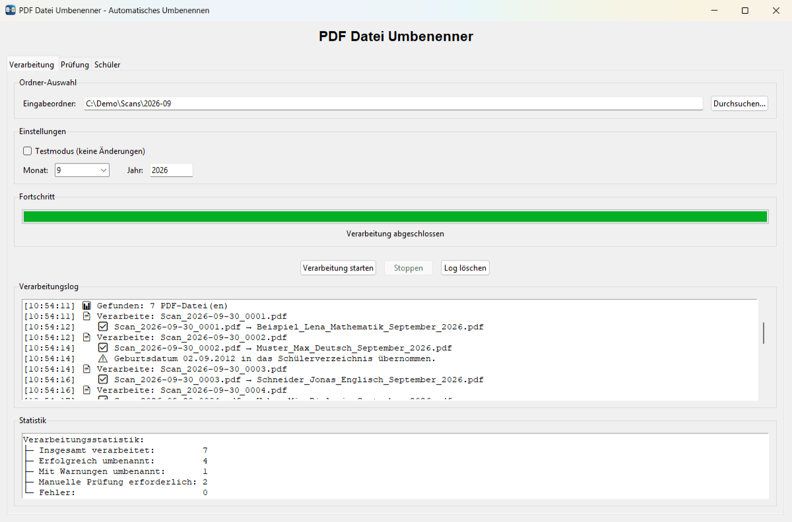
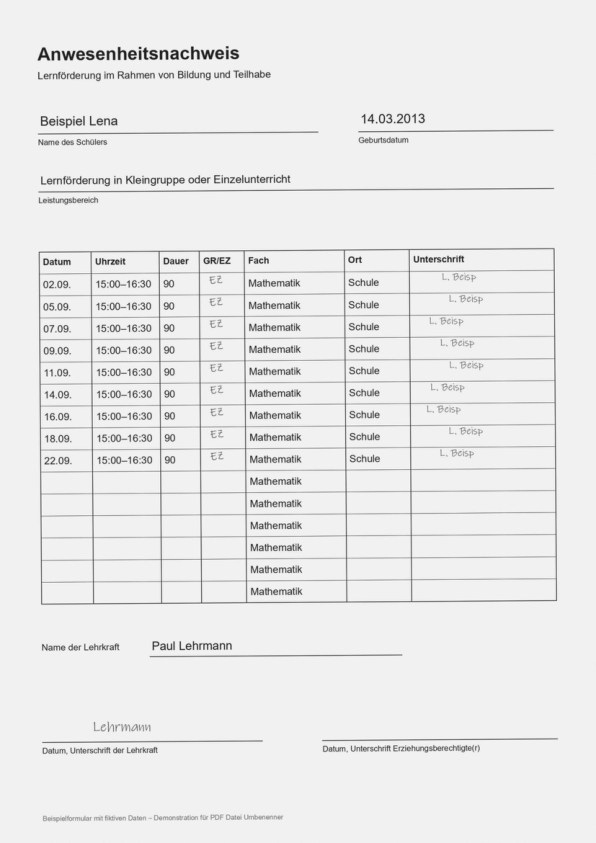
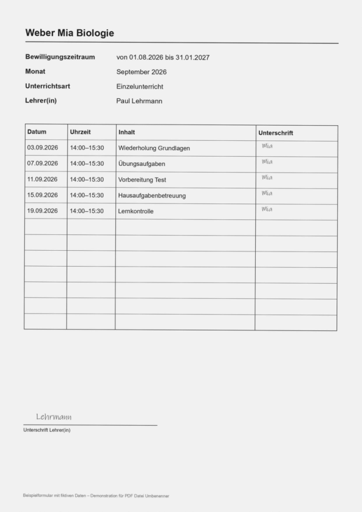
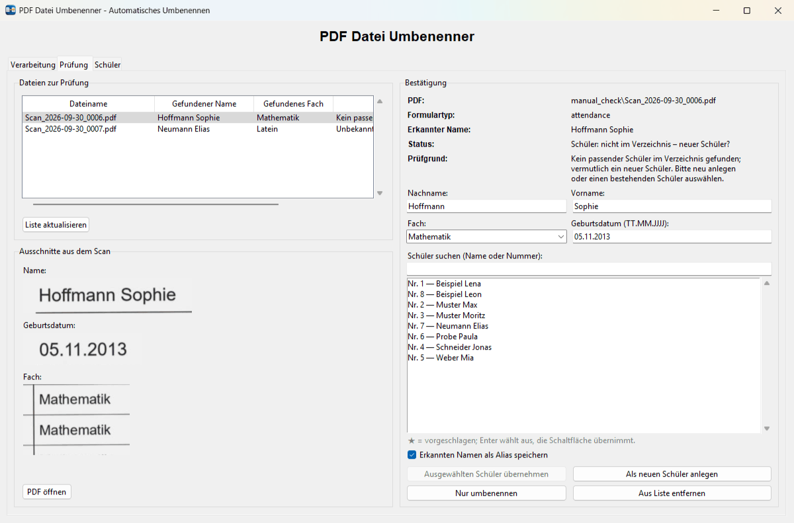
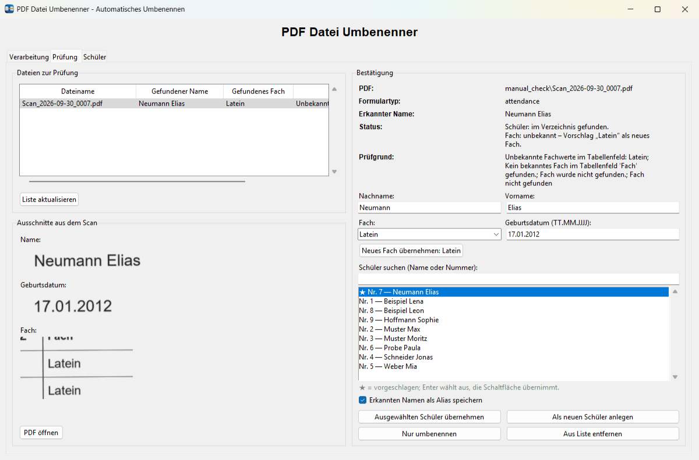
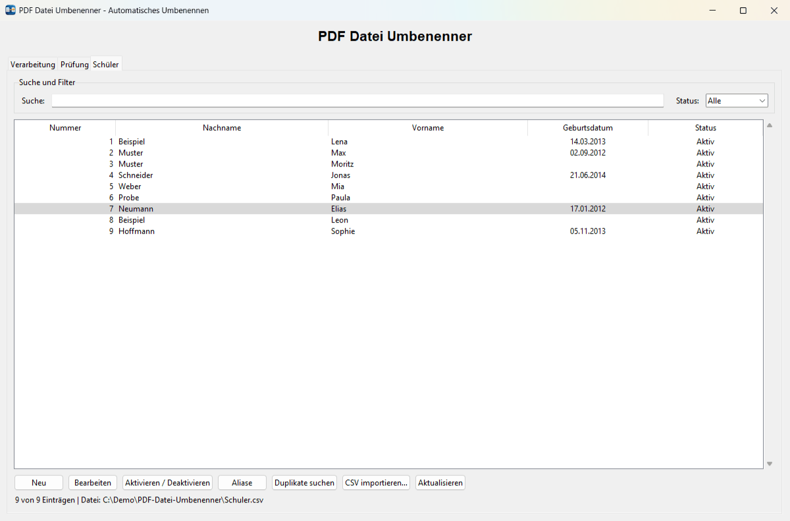

# User guide

**English** · [Deutsch](../de/user-guide.md) · [Русский](../ru/user-guide.md) · [← README](../../README.md)

The program window has three tabs: **Verarbeitung** (processing a folder of scans), **Prüfung** (review of documents the program was not certain about) and **Schüler** (the student registry). The interface is in German.

- [Processing a folder](#processing-a-folder)
- [File names](#file-names)
- [Supported forms](#supported-forms)
- [Review (Prüfung)](#review-prüfung)
- [Student registry](#student-registry)
- [Subjects](#subjects)
- [Data files](#data-files)

## Processing a folder



1. Choose the folder with the scanned PDFs (*Eingabeordner*, button *Durchsuchen…*).
2. Choose *Monat* and *Jahr*. The window opens with the current month; the period goes into every file name.
3. Optionally tick *Testmodus (keine Änderungen)* for a dry run.
4. Click **Verarbeitung starten**.

The settings are fixed when the batch starts. While it runs, the folder, the period and all registry changes are locked. *Stoppen* finishes the current PDF and stops between files; closing the window during a batch offers the same safe stop.

The log lists every document:

- ✅ renamed — `Scan_…pdf → Nachname_Vorname_Fach_Monat_Jahr.pdf`, in the same folder;
- ⚠️ a note that does not block, for example *Geburtsdatum … in das Schülerverzeichnis übernommen* (a birth date was learned) or an automatic OCR correction of the name;
- 📋 sent to review — the PDF is moved into the subfolder `manual_check`, and the reason and the prepared proposal are stored in `manual_review.json` in the scan folder.

The **Testmodus** computes the complete plan with the same names, but it moves no PDF, changes neither `Schuler.csv` nor the aliases and does not save a review queue.

Processing needs Tesseract OCR. Without it, the log and the status line show *OCR nicht verfügbar – Verarbeitung gesperrt*; the other tabs keep working. See [installation](installation.md#2-install-tesseract-ocr).

## File names

The format is always:

```text
Nachname_Vorname_Fach_Monat_Jahr.pdf
```

```text
Beispiel_Lena_Mathematik_September_2026.pdf
```

- Surname and first name are taken from the registry, not from the OCR text, so reading errors never end up in a file name.
- The subject is the canonical name from the subject list (`Mathe` → `Mathematik`).
- The month is written in German. Month and year come **only** from the selection in the program (or the CLI options) — never from dates on the form, the system clock or the original file name.
- An existing file is never overwritten. The first free suffix is used: `…_2026.pdf`, `…_2026_1.pdf`, `…_2026_2.pdf`. Names reserved earlier in the same batch count as taken, so a dry run and the real run plan identical names.

## Supported forms

| Attendance record (*Anwesenheitsnachweis*) | Older layout |
| --- | --- |
|  |  |

**Attendance record**, with or without a *GR/EZ* column:

- the student's name is the line above the label *Name des Schülers*;
- the birth date is the value above *Geburtsdatum* (optional, used as an extra identification key);
- the subject is read from the *Fach* column of the attendance table. It is usually printed in every row; the consistent majority wins. Entries of the *GR/EZ* column (group or individual lessons, often handwritten as `EZ`, `E2`, `&z`) are never taken for the subject.

**Older layout:** a header line *Nachname Vorname Fach* above the fields *Bewilligungszeitraum*, *Monat*, *Unterrichtsart* and *Lehrer(in)*.

The layout is recognised from the labels on the page, never from the file name. One form belongs to one subject. Teacher, place, *GR/EZ*, the BG number and signatures are never used to identify the student or to build the file name; `Lehrer.csv` plays no part in renaming. Name and subject are normally typed; handwritten names are rare and go to review.

## Review (Prüfung)



A document goes to review when the program is not certain, for example:

- the student is not in the registry (*vermutlich ein neuer Schüler*);
- several students are similar, or two readings point to different students;
- the birth date on the form contradicts the registry;
- the subject is unknown, contradictory or unreadable;
- OCR failed for this document.

**Left side:** the list of documents to review and, below it, fragments of the original scan — name, birth date and the first rows of the *Fach* column (for older queue entries without field positions, a thumbnail of the page). *PDF öffnen* opens the file in the default PDF viewer.

**Right side:** the status line states what has to be decided (*Schüler: …*, *Fach: …*), followed by the recognised name, surname, first name, subject and birth date (`TT.MM.JJJJ`, editable), the student search and the actions.

**Student search** works while typing: parts of the surname, first name or the number in any order, case-insensitive. Without a query, the suggested candidates come first (★, by similarity); if nothing matches literally, ≈ marks similar names. A clear leader is preselected. *Enter* and the arrow keys only select a student; *Escape* clears the search; changing the query or the document discards the selection.

| Action | Effect |
| --- | --- |
| **Ausgewählten Schüler übernehmen** | Renames the PDF for the selected student. With *Erkannten Namen als Alias speichern* the recognised spelling is remembered, so the next scan with the same spelling is identified automatically. |
| **Als neuen Schüler anlegen** | Adds a new student with the prefilled surname, first name and birth date (correct them if needed) and renames the PDF. |
| **Neues Fach übernehmen: …** | Appears when an unknown subject is printed consistently. After confirmation the subject is added to `subjects_config.json` and applies immediately. |
| **Nur umbenennen** | Renames the PDF without changing the registry (after a separate confirmation). |
| **Aus Liste entfernen** | Removes the entry from the queue; the PDF stays in `manual_check`. |



The renamed file is moved back into the scan folder. The period stored with the queue entry is used. The birth date from the form is saved for the chosen or new student if the registry does not contain one yet — an existing date is never overwritten. Registry and aliases are saved before the PDF is moved; if a step fails, the entry stays in the queue and can be applied again without creating a duplicate student. A list of contradictory values (for example *Deutsch, Englisch*) is never saved as an alias.

## Student registry



The **Schüler** tab lets you search and filter, add and edit students, activate or deactivate them (history is kept), view and delete wrong aliases, look for possible duplicates and import an updated CSV file.

`Schuler.csv` lives in the program folder. Minimal format:

```csv
Nummer;Nachname;Vorname
1;Beispiel;Lena
```

- UTF-8 with or without BOM; the historical header `Forname` is accepted as well as `Vorname` (if both exist, they must agree).
- Optional columns: `Aktiv` (yes/no values) and `Geburtsdatum` (`TT.MM.JJJJ`; an empty cell means unknown). Additional columns, their order and the BOM are preserved.
- **Import** accepts `;`, `,`, tab and `|` as separators and first shows a comparison: new, unchanged, conflicting, duplicate and missing entries. After confirmation only new, conflict-free rows are added; conflicts are never overwritten and missing historical entries are never deleted. A backup `Schuler.csv.bak` (or the next free suffix) is written first, and the file is replaced atomically. Duplicate search and import run in the background; meanwhile other registry changes and processing are locked.
- If the CSV or the alias file was changed outside the program, click *Aktualisieren* before editing.

**Birth date.** The optional `Geburtsdatum` is an extra identification key: a match strengthens a decision, while a confidently read different date forbids an automatic decision even for an exact name (a single confusion of similar digits such as 5/6 is not treated as a contradiction). A date is filled in automatically only for a student without one — from a document with an exact name and a clean reading of the date, or by an operator decision in *Prüfung*. The column is added with a backup when it is first needed. The registry with birth dates is personal data and stays local.

**Aliases** are confirmed alternative spellings, stored next to the CSV in `student_aliases.json`:

```json
{"version": 1, "aliases": [{"name": "Beispie1 Lena", "student_number": 1}]}
```

Only an operator decision creates an alias; automatic corrections never do.

## Subjects

`subjects_config.json` contains the list of subjects and standard abbreviations:

```json
{
  "subjects": ["Biologie", "Chemie", "Deutsch", "Englisch", "Geografie", "Informatik",
               "Mathematik", "Physik", "Sachkunde", "Sachunterricht"],
  "aliases": {"Mathe": "Mathematik", "Bio": "Biologie", "Geo": "Geografie", "Sachunt.": "Sachunterricht"}
}
```

*Sachkunde* and *Sachunterricht* are different subjects. Misread subject names are matched to the list if exactly one subject is close enough. A new subject is added either by editing the file or with *Neues Fach übernehmen* in the review tab. Confirmed corrections of subject spellings are stored in `subjects_aliases.json`.

## Data files

| File | Location | Content | In Git |
| --- | --- | --- | --- |
| `Schuler.csv` | program folder | student registry (personal data) | no |
| `student_aliases.json` | program folder | confirmed spellings of student names | no |
| `Lehrer.csv` | program folder | teacher list; not used for renaming | no |
| `subjects_config.json` | program folder | subject list and abbreviations | yes (defaults) |
| `subjects_aliases.json` | program folder | confirmed subject spellings | yes (empty) |
| `manual_review.json` | each scan folder | review queue with proposals and evidence | no |
| `manual_check\` | each scan folder | PDFs waiting for review | no |
| `.launcher-logs\` | program folder | diagnostic logs | no |
| `.venv\`, `.bootstrap\` | program folder | private Python environment and its backups | no |

CSV and JSON files are always written via a temporary file and an atomic replacement. A damaged queue or alias file is never silently replaced with an empty one: the program reports the error and leaves the file untouched.
