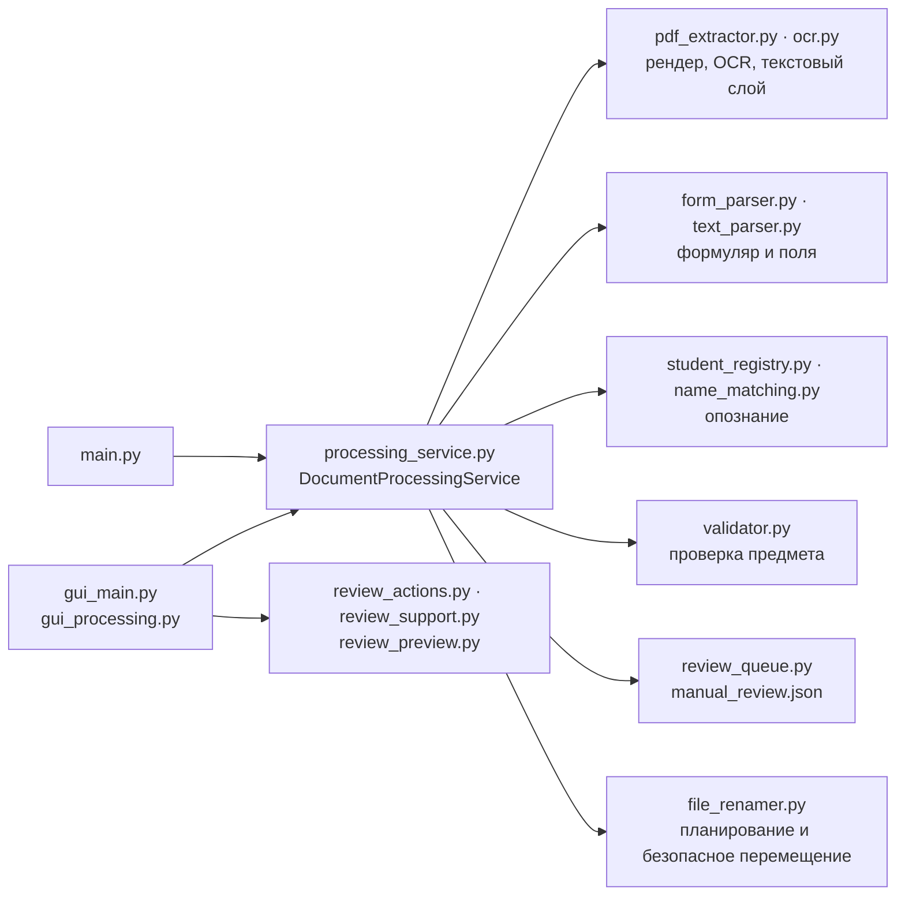

# Разработка

[English](../en/development.md) · [Deutsch](../de/development.md) · **Русский** · [← README](../../README.ru.md)

- [Окружение](#окружение)
- [Архитектура](#архитектура)
- [Командная строка](#командная-строка)
- [Python API](#python-api)
- [Тесты](#тесты)
- [Проверки состояния](#проверки-состояния)
- [Стенд измерения](#стенд-измерения)
- [Демонстрационные данные](#демонстрационные-данные)
- [Соглашения](#соглашения)

## Окружение

Приложение рассчитано на Windows (интерфейс Tkinter, BAT-лаунчеры) и Python 3.10–3.15. После того как `setup.bat` создал `.venv`:

```cmd
.venv\Scripts\python.exe -m pip install -r requirements-dev.txt
.venv\Scripts\python.exe -m pytest
```

`requirements.txt` содержит зависимости времени выполнения (`pdfplumber`, `PyMuPDF`, `Pillow`), `requirements-dev.txt` добавляет `pytest`. Tesseract OCR с `deu` нужен для реальных OCR-тестов и для обработки.

## Архитектура

Конвейер обработки ровно один. GUI и CLI используют `DocumentProcessingService`; старые точки входа (`gui_minimal.py`, `processing_pipeline.py`) — тонкие совместимые псевдонимы.



| Модуль | Ответственность |
| --- | --- |
| `pdf_extractor.py`, `ocr.py`, `page_data.py` | Текстовый слой, рендер страницы (PyMuPDF), вызовы Tesseract с ограничением времени, определение ориентации, OCR фрагментов |
| `form_parser.py`, `text_parser.py` | Определение формуляра, поиск подписей с допуском, чтение имени/даты рождения/предмета, доказательства по полям |
| `name_matching.py` | Взвешенное сравнение имён с учётом ошибок OCR и сравнение дат рождения |
| `student_registry.py`, `student_registry_service.py` | Справочник, алиасы, опознание, редактирование, импорт CSV с предпросмотром |
| `processing_service.py` | Управление конвейером, решения, планирование пакета, откат |
| `review_queue.py`, `review_actions.py`, `review_support.py`, `review_preview.py` | Устойчивая очередь проверки, решения оператора, ранжирование поиска, фрагменты скана |
| `file_renamer.py`, `validator.py`, `alias_manager.py` | Переименование без коллизий, проверка предмета, алиасы предметов |
| `gui_main.py`, `gui_processing.py`, `start_gui.py`, `desktop_integration.py` | Интерфейс Tkinter, фоновая обработка пакета, точка входа лаунчеров, интеграция с Windows |
| `bootstrap.py`, `*.bat`, `install_*.ps1` | Проверки состояния, подготовка окружения, лаунчеры, подписанные установщики |

## Командная строка

CLI требует явных месяца и года:

```cmd
.venv\Scripts\python.exe main.py C:\Scans\2026-09 --month 9 --year 2026
.venv\Scripts\python.exe main.py C:\Scans\2026-09 --month 9 --year 2026 --dry-run
```

`--tesseract-path` явно задаёт исполняемый файл Tesseract; без папки `main.py` запускает GUI. CLI записывает очередь проверки и папку `manual_check` в обрабатываемую папку. Ошибка отдельного PDF не останавливает пакет.

| Код возврата | Значение |
| --- | --- |
| `0` | Пакет завершён |
| `2` | Были ошибки обработки или сохранения очереди |
| `3` | OCR недоступен — обработка не начиналась |

## Python API

```python
from pathlib import Path
from main import build_processing_service

folder = Path(r"C:\Scans\2026-09")
service = build_processing_service(folder, registry_csv=Path("Schuler.csv"))
batch = service.process_batch(sorted(folder.glob("*.pdf")), month=9, year=2026, dry_run=True)
for result in batch.results:
    print(result.pdf_path.name, result.planned_action.value, result.planned_name)
```

- `process_document(path, month, year, dry_run=False)` возвращает `ProcessingResult`: завершённые стадии, извлечённые и канонические данные, сопоставление ученика, проверку предмета, предупреждения, план действия (`rename` / `manual_review`), планируемые имя и путь, запись очереди и — при сбое — `error`, `failed_stage` и `actual_path`.
- `process_batch(paths, month, year, dry_run=False)` начинает новый пакет резервирования имён и возвращает `BatchProcessingResult`.
- Зависимости (извлечение, парсер, справочник, валидатор, очередь, переименование) передаются в конструктор, поэтому сервис удобно тестировать.

Справочник (`student_registry.StudentRegistry`) не зависит от GUI:

- `identify(NameEvidence(...))` — решение по всем чтениям и дате рождения: `exact`, `auto_corrected`, `ambiguous`, `unknown` или `error`, с ранжированными кандидатами и предложением нового ученика;
- `match(raw_name)` / `match_parts(last_name, first_name)` — строгое сопоставление одного имени;
- изменения только явными вызовами: `confirm_existing(raw_name, number, save_alias=True)`, `confirm_new(last_name, first_name, birth_date=None)`, `update_student(number, ...)`, `learn_birth_date(number, date)`. Ошибки возвращаются как `RegistryValidationError`, `RegistryUnavailableError` или `RegistryWriteError`.

## Тесты

Набор pytest (около 550 тестов, 2–3 минуты) покрывает:

- конвейер с имитацией OCR для управления и отказов — откат, коллизии, повреждённые файлы, превышение времени;
- чтение формуляров, правила опознания и отрицательные случаи: однофамильцев, братьев и сестёр, похожих новых учеников, противоречащие чтения и даты рождения, конфликтующие и неизвестные предметы;
- интерфейс на реальных виджетах Tk (проверка, справочник, раскладка на малых экранах);
- BAT-лаунчеры в настоящем `cmd.exe` с заглушками вспомогательных программ: пути с пробелами, `&`, `!`, умлаутами; паузы; UNC и OneDrive; ветку установки Python; ярлыки;
- `install_python.ps1` без сети (ошибки загрузки, неподписанные и чужой подписью подписанные файлы);
- реальный Tesseract на синтетических формулярах, в том числе на повёрнутых страницах, и сквозной прогон на демонстрационных сканах.

Тесты, которым нужны Windows, дисплей для Tk или Tesseract, автоматически пропускаются, если их нет. В тестах используются только вымышленные данные.

## Проверки состояния

```cmd
.venv\Scripts\python.exe bootstrap.py check-packages
.venv\Scripts\python.exe bootstrap.py check-core
.venv\Scripts\python.exe bootstrap.py check-ocr
```

`check-packages` импортирует только обязательные пакеты, `check-core` дополнительно проверяет tkinter, импорт приложения и файлы данных, `check-ocr` — Tesseract и языковые данные. Они возвращают [коды возврата](installation.md#коды-возврата) лаунчеров.

## Стенд измерения

`tools/evaluate_recognition.py` измеряет качество распознавания на папке реальных сканов — всегда в режиме пробного прогона:

```cmd
.venv\Scripts\python.exe tools\evaluate_recognition.py Scans --month 9 --year 2026
.venv\Scripts\python.exe tools\evaluate_recognition.py <папка переименованных PDF> --from-filenames
```

Эталон — `_expected.csv` в папке сканов (`Datei;Nachname;Vorname;Fach`) или имена уже переименованных PDF. Стенд считает правильные и **ошибочные** автоматические решения, оправданные проверки (ученика или предмета нет в списках), лишние проверки, ошибки и время на документ. `--registry` подставляет другой справочник (например, временную копию), `--report` сохраняет таблицу. До и после прогона сравниваются SHA-256 всех PDF и файлов данных.

Коды возврата: `0` — ошибочных решений нет, `1` — есть ошибочные автоматические решения, `2` — ошибка параметров или эталона, `3` — во время прогона изменились данные. Эталон и отчёты содержат имена, поэтому `_expected.csv` и `recognition_report*` исключены из Git.

## Демонстрационные данные

[`demo/`](../../demo/) содержит семь вымышленных сканов, соответствующий справочник и два скрипта:

- `demo/make_demo_scans.py` заново создаёт сканы (формуляр посещаемости с *GR/EZ* и без, старый формуляр, страница вверх ногами, новый ученик и новый предмет);
- `demo/run_demo.py` обрабатывает копию в `demo/output` (`--dry-run`, `--month`, `--year`, `--output`). Тест `tests/test_demo_scans.py` следит, чтобы описанные результаты оставались верными.

## Соглашения

- Один конвейер для GUI и CLI; ни одна точка входа не получает собственных правил распознавания.
- Сообщения GUI, CLI и лаунчеров — на немецком. BAT-файлы — ASCII с концами строк CRLF (`ae/oe/ue` вместо умлаутов).
- Новые прямые зависимости объявляются в нужном файле requirements в том же изменении.
- Персональные данные никогда не попадают в репозиторий: никаких реальных имён, дат рождения, номеров BG и OCR-текста реальных сканов в тестах, фикстурах, документации и issue.
- Ошибочное автоматическое решение хуже проверки: новые эвристики требуют отрицательных тестов (однофамильцы, похожие имена, противоречия) и прогона стенда с **0 ошибочных решений**.
