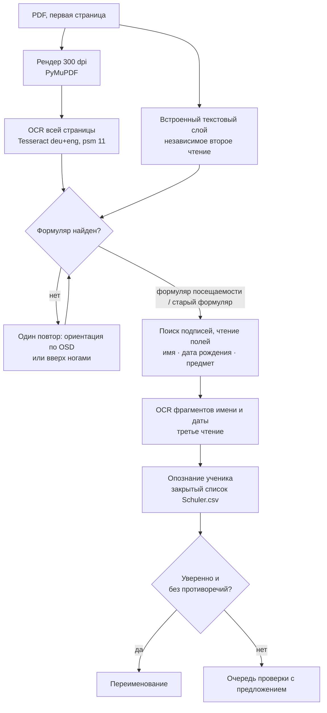

# Как работает распознавание

[English](../en/how-it-works.md) · [Deutsch](../de/how-it-works.md) · **Русский** · [← README](../../README.ru.md)

Главный принцип: **ошибочное автоматическое переименование хуже лишней проверки.** Поэтому каждый шаг собирает доказательства, и документ переименовывается автоматически, только если результату ничто не противоречит. При сомнении он идёт на проверку — с готовым предложением.

## 1. Чтение страницы

Сканеры часто добавляют текстовый слой, но на реальных офисных сканах он сильно испорчен («Anwosenheitsnochweis», кириллические буквы внутри немецких слов). Поэтому программа **распознаёт каждый документ**:

- первая страница рендерится PyMuPDF в 300 dpi с учётом поворота, записанного в PDF;
- Tesseract читает её с языками `deu` и `eng` в режиме сегментации 11 (разреженный текст). Замеры на реальных сканах показали, что стандартный режим 3 на части страниц теряет колонку *Fach* таблицы;
- текстовый слой сканера сохраняется как **независимое второе чтение** и как запасной вариант, если OCR документа не удался;
- если структура формуляра не найдена ни в одном чтении, страница один раз читается заново — с поворотом, который определил модуль ориентации Tesseract (`osd`), иначе вверх ногами. Повтор принимается, только если в нём найден формуляр;
- у каждого вызова Tesseract есть ограничение времени (120 с на распознавание, 20 с на запросы). Неудачный или прерванный по времени OCR отправляет документ на проверку с диагностикой.

Одинаковые результаты разных настроек OCR одного изображения не считаются независимыми доказательствами; OCR изображения и текстовый слой сканера — считаются.

## 2. Определение формуляра

Вид формуляра определяется по напечатанным подписям, которые сравниваются с допуском на типичные ошибки OCR — может отличаться около четверти букв (*Anwesenheitsnachweis* до 5 ошибок, *Geburtsdatum* 3, *Fach* и *Dauer* 1), короткие подписи вроде *Ort* должны совпадать точно. Кириллические и другие похожие буквы предварительно нормализуются.

| Формуляр | Подписи | Решение |
| --- | --- | --- |
| Формуляр посещаемости | *Anwesenheitsnachweis*, *Name des Schülers*, *Fach*, *Name der Lehrkraft* | не менее 3 из 4 |
| Старый формуляр | *Bewilligungszeitraum*, *Monat*, *Unterrichtsart*, *Lehrer(in)* | не менее 2 из 4 |

## 3. Чтение полей

- **Имя** (формуляр посещаемости): строка над *Name des Schülers*, левее *Geburtsdatum*. Короткие обрывки подписей отбрасываются; строка с цифрами или символами внутри длинных слов считается неправдоподобной. В старом формуляре имя берётся из строки заголовка.
- **Дата рождения:** форматы вроде `14.03.2013` и типичные варианты OCR (`1403 2013`, `1O` → `10`), принимается только при правдоподобном возрасте 2–30 лет. Отсутствие даты никогда не блокирует.
- **Третье чтение:** области имени и даты вырезаются и повторно распознаются как одна строка. Так у каждого поля бывает до трёх чтений — OCR страницы, OCR фрагмента и текстовый слой.
- **Предмет:** колонка *Fach* ограничивается соседями (*GR/EZ* или *Dauer* слева, *Ort* справа). Значения колонки *GR/EZ* и их варианты OCR отбрасываются. Каждая строка сравнивается с каталогом предметов (канонические предметы, сокращения и подтверждённые алиасы); неверно прочитанное слово длиной от 5 букв может совпасть с предметом при ошибке до четверти букв, но только если ни один другой предмет не так же близок. Решает согласованное большинство строк. Неизвестное слово, напечатанное в двух и более строках, становится **предложением нового предмета** для проверки.
- Отсутствие соседней подписи (*Dauer*, *Ort*, *Name der Lehrkraft*, *Geburtsdatum*) даёт лишь замечание, если поле всё же найдено и его содержимое согласовано (один предмет минимум в трёх строках); иначе блокирует.

Для каждого поля очередь хранит доказательства: все чтения, положение на странице (для фрагментов скана на вкладке проверки) и причины сомнений.

## 4. Опознание ученика

Справочник — **закрытый список**: программа выбирает только между учениками из `Schuler.csv`.

1. **Точное совпадение.** Если какое-либо чтение совпадает с именем ученика или подтверждённым алиасом (в обоих порядках), выбирается этот ученик — если только другое чтение явно не указывает на другого ученика или не противоречит дата рождения.
2. **Автоматическое исправление OCR** — только при выполнении *всех* условий:
   - поле имени найдено по структуре формуляра;
   - чтение отличается от одного ученика лишь типичными путаницами OCR печатного текста;
   - сходство ≥ 0,85, каждая часть имени ≥ 0,75 и отрыв от следующего кандидата ≥ 0,25;
   - ничто не противоречит — в частности, независимые чтения, одинаково дающие написание с настоящими отличиями, считаются противоречием.

   При совпадении сохранённой даты рождения правило смягчается: сходство ≥ 0,70, каждая часть ≥ 0,55 и не больше двух настоящих отличий.
3. **Противоречащая дата рождения.** Уверенно прочитанная дата, отличная от справочника, запрещает автоматическое решение даже при точном имени. Одна путаница похожих цифр (0/6, 0/8, 6/8, 3/8, 5/6, 3/5, 1/7, 1/4) считается «близкой», а не противоречием.
4. **Новый ученик.** Если лучшее сходство ниже 0,70, документ идёт на проверку как *vermutlich ein neuer Schüler* с предложением (фамилия, имя, дата рождения).

Сходство — взвешенное расстояние редактирования. Типичные путаницы OCR стоят 0,3 вместо 1: `i/l/1/j`, `l/t`, `t/f`, `f/l`, `o/a`, `o/0`, `e/c`, `u/n`, `n/h`, `h/b`, `m/n`, `s/5`, `b/8`, `g/9`, `z/2` и группы `rn/m`, `cl/d`, `vv/w`, `ii/u`, `ri/n`. Пары вроде `a/e` или `o/e` намеренно **не** дешёвые: *Anna* и *Anne* могут быть разными людьми.

Автоматические исправления отмечаются в результате (что прочитано, какой ученик выбран); они никогда не создают алиасов и не обучают даты рождения. Дата рождения запоминается только после успешного переименования при точном совпадении и чистом чтении даты.

## 5. Имена и сохранность файлов

- Имя файла строится из канонических фамилии и имени из справочника, канонического предмета и выбранного периода.
- Целевые имена планируются до любых перемещений: существующие файлы и имена, уже занятые в пакете, считаются занятыми, выбирается первый свободный суффикс `_1`, `_2`, … Пробный и реальный прогоны дают одинаковый план.
- CSV и JSON записываются через временный файл, `fsync` и атомарную замену. Если не удалась даже очистка, сообщаются обе ошибки и путь временного файла.
- Если очередь проверки не удалось сохранить, программа пытается вернуть PDF на исходное место и явно сообщает об ошибке. Если при переносе между дисками не удалось удалить исходник, созданная копия удаляется; если не удалось и это, сообщаются оба пути.
- Повреждённая очередь или файл алиасов открываются в режиме fail-closed: программа сообщает ошибку вместо замены файла пустым.
- Ничего никогда не удаляется; ошибка одного PDF не останавливает пакет.

## 6. Ограничения

- Читается только первая страница.
- Имя и предмет должны быть напечатаны. Рукописные записи редки и обычно попадают на проверку; распознавания рукописного текста нет.
- Пороги подобраны на 17 реальных сканах и синтетических тестах. Это обоснованная настройка, а не статистическая гарантия — поэтому неуверенные случаи всегда идут на проверку.
